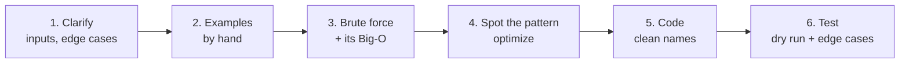

# Phase 0: Basics (Big-O + Python Toolkit)

[← Roadmap](README.md) · [Next: Phase 1 →](01-arrays-and-strings.md)

Do this phase first, even if it feels easy. Every later pattern is explained using these words.

---

## 0.1 Big-O: how fast does my code grow?

**Big-O** describes how the number of steps grows when the input grows. It ignores small details. It only cares about the shape of the growth.

Analogy: finding a name in a phone book.
- Read every page: **O(n)**. Twice the book means twice the time.
- Open in the middle and keep halving: **O(log n)**. Twice the book means only one extra step.

| Big-O | Name | Example | 1,000,000 items ≈ |
|---|---|---|---|
| O(1) | constant | `d[key]`, `x in my_set` | 1 step |
| O(log n) | logarithmic | binary search | 20 steps |
| O(n) | linear | one `for` loop | 1,000,000 steps |
| O(n log n) | n log n | `sorted()` | 20,000,000 steps |
| O(n²) | quadratic | two nested loops | 10¹² steps (too slow) |
| O(2ⁿ) | exponential | all subsets | impossible beyond n ≈ 25 |
| O(n!) | factorial | all orderings | impossible beyond n ≈ 11 |

### Read the constraints, guess the solution

Python does roughly **10⁷ simple steps per second**. LeetCode gives you about 1–2 seconds. So the input size tells you what speed you need.

| If `n` is up to… | You can afford… | Usually means… |
|---|---|---|
| 10 | O(n!) | permutations, backtracking |
| 20 | O(2ⁿ) | subsets, bitmask DP |
| 500 | O(n³) | interval DP, Floyd-Warshall |
| 5,000 | O(n²) | 2D DP, nested loops |
| 100,000 – 1,000,000 | O(n log n) or O(n) | sorting, heap, binary search, two pointers, sliding window, hashing |
| 10⁹ or more | O(log n) or O(1) | binary search on the answer, math |

**The trap:** space counts too. A recursion that goes `n` levels deep uses O(n) memory for the call stack, even if you create no lists.

---

## 0.2 Python cost of common operations

These are the costs that interviewers ask about.

| Operation | Cost | Note |
|---|---|---|
| `lst.append(x)`, `lst.pop()` | O(1) | end of a list is cheap |
| `lst.pop(0)`, `lst.insert(0, x)` | **O(n)** | shifts every item. Use `deque` instead |
| `x in lst` | **O(n)** | scans the whole list |
| `x in my_set`, `x in my_dict` | O(1) average | hashing |
| `lst[a:b]`, `s[a:b]` | O(b − a) | slicing **copies** |
| `sorted(lst)`, `lst.sort()` | O(n log n) | |
| `s = s + "a"` in a loop | **O(n²)** total | strings can't be changed; build a list and `"".join(parts)` |
| `heapq.heappush`, `heappop` | O(log n) | |
| `bisect.bisect_left` | O(log n) | needs a sorted list |

---

## 0.3 The Python toolkit

Learn these by heart. Every pattern below uses them.

```python
from collections import Counter, defaultdict, deque
import heapq
import bisect

# ---------- dict: key -> value ----------
# Make an empty dictionary
ages = {}
# Add or change a value
ages["sam"] = 25
# Read with a default when the key is missing
print(ages.get("bob", 0))  # 0

# ---------- Counter: counts things for you ----------
# Count every letter in a word
counts = Counter("banana")
print(counts["a"])  # 3

# ---------- defaultdict: dict that creates missing keys ----------
# Every new key starts as an empty list
groups = defaultdict(list)
# No need to check if "fruits" exists first
groups["fruits"].append("apple")
print(groups["fruits"])  # ['apple']

# ---------- set: unique items, fast "in" ----------
# Make a set from a list (duplicates disappear)
seen = set([1, 2, 2, 3])
print(2 in seen)  # True

# ---------- deque: fast add/remove at BOTH ends ----------
# A queue for BFS
queue = deque()
# Add to the right end
queue.append(1)
queue.append(2)
# Remove from the left end in O(1)
print(queue.popleft())  # 1

# ---------- heapq: always gives the SMALLEST item ----------
# A heap is just a list that heapq keeps in a special order
heap = []
heapq.heappush(heap, 5)
heapq.heappush(heap, 1)
heapq.heappush(heap, 3)
# Remove and return the smallest
print(heapq.heappop(heap))  # 1
# For a MAX-heap, push negative numbers
max_heap = []
heapq.heappush(max_heap, -5)
heapq.heappush(max_heap, -9)
print(-heapq.heappop(max_heap))  # 9

# ---------- bisect: binary search on a sorted list ----------
sorted_nums = [1, 3, 3, 5]
# First index where 3 could go (left of existing 3s)
print(bisect.bisect_left(sorted_nums, 3))  # 1
# First index after all the 3s
print(bisect.bisect_right(sorted_nums, 3))  # 3

# ---------- sorting with a key ----------
pairs = [[1, 9], [3, 2], [2, 5]]
# Sort by the second number of each pair
pairs.sort(key=lambda pair: pair[1])
print(pairs)  # [[3, 2], [2, 5], [1, 9]]

# ---------- infinity ----------
# Handy starting value when looking for a minimum
best = float("inf")
print(best > 10 ** 18)  # True
```

**Recursion depth:** Python stops recursion at about 1,000 levels. For deep trees or big grids, add this at the top of your file:

```python
import sys
# Allow deeper recursion (default is about 1000)
sys.setrecursionlimit(10 ** 6)
print(sys.getrecursionlimit())  # 1000000
```

---

## 0.4 How to attack any interview problem



1. **Clarify.** Can the input be empty? Negative numbers? Duplicates? Is it sorted?
2. **Examples.** Solve one small example by hand. Notice what your brain did.
3. **Brute force.** Say it out loud with its Big-O. This shows you understand the problem.
4. **Optimize.** Use the [pattern cheat sheet](README.md#spot-the-pattern-cheat-sheet). Ask: *what work am I repeating?*
5. **Code.** Clear names. Small helper functions.
6. **Test.** Walk through your code line by line with a tiny input. Then try the edge cases: empty, one item, all the same, very large.

**The trap:** jumping straight to code. Interviewers grade your thinking (steps 1–4) as much as your code.

---

## Warm-up questions

**Easy**

| # | Problem | Hint |
|---|---|---|
| 1480 | [Running Sum of 1d Array](https://leetcode.com/problems/running-sum-of-1d-array/) | Keep a running total in one loop |
| 1929 | [Concatenation of Array](https://leetcode.com/problems/concatenation-of-array/) | Python list + list |
| 412 | [Fizz Buzz](https://leetcode.com/problems/fizz-buzz/) | Check 15 before 3 and 5 |
| 9 | [Palindrome Number](https://leetcode.com/problems/palindrome-number/) | Reverse half the digits with % and // |
