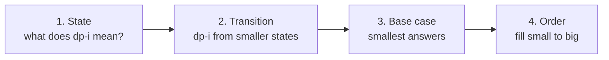
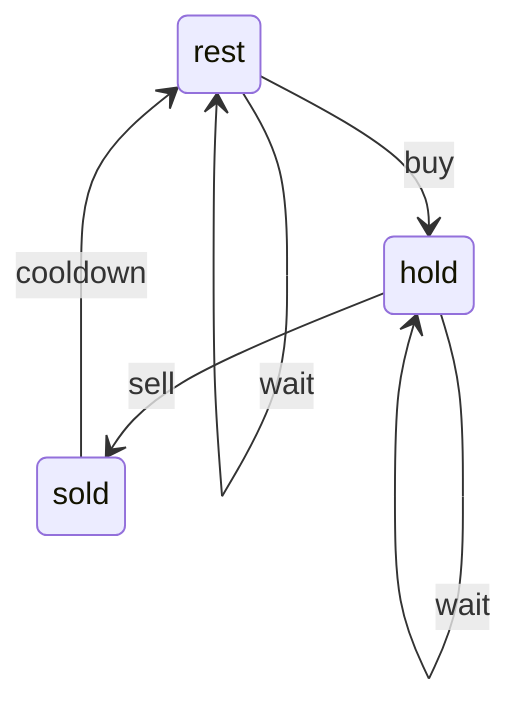

# Phase 5: Dynamic Programming, Greedy & Bits

[← Phase 4](04-recursion-and-graphs.md) · [Roadmap](README.md) · [Next: Phase 6 →](06-advanced.md)

DP is the topic that separates good candidates from great ones. Learn the **framework** once, then each pattern is just a new "state".

| # | Pattern | State looks like |
|---|---|---|
| 22 | [1D DP](#pattern-22-1d-dp) | `dp[i]` = best answer for the first i items |
| 23 | [Grid DP](#pattern-23-grid-dp) | `dp[r][c]` = best answer to reach cell (r, c) |
| 24 | [Knapsack](#pattern-24-knapsack) | `dp[capacity]` |
| 25 | [Longest Increasing Subsequence](#pattern-25-longest-increasing-subsequence-lis) | `dp[i]` = best chain ending at i |
| 26 | [String DP (two strings)](#pattern-26-string-dp) | `dp[i][j]` = answer for `a[:i]` and `b[:j]` |
| 27 | [Interval DP](#pattern-27-interval-dp) | `dp[i][j]` = answer for the range i..j |
| 28 | [State Machine DP](#pattern-28-state-machine-dp-stocks) | `hold`, `sold`, `rest`… |
| 29 | [Greedy](#pattern-29-greedy) | no table: best local choice |
| 30 | [Bit Manipulation](#pattern-30-bit-manipulation) | numbers as rows of 0/1 |

---

## The DP framework (read this first)

**DP** (Dynamic Programming) = recursion + **remembering answers** so you never solve the same small problem twice.

Analogy: what is 1+1+1+1+1? "5". Add another +1: you answer "6" instantly, because you remembered 5. You didn't recount.

**Spot DP when:** "count the number of ways", "minimum / maximum cost", "is it possible", **and** a choice at each step affects later steps. If brute force is "try every choice" and the same sub-questions repeat, it's DP.

Answer these 4 questions every time:



Two ways to write the same DP:

```python
from functools import cache


# Top-down (memoization): recursion + cache. Easiest to write first.
def rob_top_down(nums):
    @cache
    def best(i):
        # No houses left
        if i >= len(nums):
            return 0
        # Skip house i, or rob it and skip the next one
        skip = best(i + 1)
        take = nums[i] + best(i + 2)
        return max(skip, take)

    return best(0)


# Bottom-up (tabulation): a loop. Faster, no recursion limit.
def rob_bottom_up(nums):
    # best from 2 houses back, and from 1 house back
    two_back = 0
    one_back = 0
    for money in nums:
        current = max(one_back, two_back + money)
        two_back = one_back
        one_back = current
    return one_back


print(rob_top_down([2, 7, 9, 3, 1]))  # 12
print(rob_bottom_up([2, 7, 9, 3, 1]))  # 12
```

**The trap:** jumping to the bottom-up table. Write the recursive version first, add `@cache`, and only then convert it if needed.

---

## Pattern 22: 1D DP

**Idea:** the answer at position `i` depends on a few earlier positions (`i-1`, `i-2`, or every `j < i`).

**Spot it when:** a single list or string, and you move left to right making choices: climb stairs, rob houses, decode a message, break a string into words.

```python
def word_break(s, words):
    word_set = set(words)
    # can[i] = True if s[:i] can be split into words
    can = [False] * (len(s) + 1)
    # The empty string can always be split
    can[0] = True
    for i in range(1, len(s) + 1):
        for j in range(i):
            # s[:j] splits, and s[j:i] is a word
            if can[j] and s[j:i] in word_set:
                can[i] = True
                break
    return can[len(s)]


def max_subarray(nums):
    # Kadane: best sum of a subarray ending here
    current = nums[0]
    best = nums[0]
    for i in range(1, len(nums)):
        # Either extend the previous subarray or start fresh here
        current = max(nums[i], current + nums[i])
        best = max(best, current)
    return best


print(word_break("leetcode", ["leet", "code"]))  # True
print(max_subarray([-2, 1, -3, 4, -1, 2, 1, -5, 4]))  # 6
```

### Questions

**Easy**

| # | Problem | Hint |
|---|---|---|
| 70 | [Climbing Stairs](https://leetcode.com/problems/climbing-stairs/) ★ | dp[i] = dp[i-1] + dp[i-2] |
| 746 | [Min Cost Climbing Stairs](https://leetcode.com/problems/min-cost-climbing-stairs/) ★ | cost + min of two previous |
| 509 | [Fibonacci Number](https://leetcode.com/problems/fibonacci-number/) | Two variables |

**Medium**

| # | Problem | Hint |
|---|---|---|
| 198 | [House Robber](https://leetcode.com/problems/house-robber/) ★ | max(skip, take + dp[i-2]) |
| 213 | [House Robber II](https://leetcode.com/problems/house-robber-ii/) ★ | Run twice: drop first / drop last |
| 740 | [Delete and Earn](https://leetcode.com/problems/delete-and-earn/) | Turns into House Robber on values |
| 91 | [Decode Ways](https://leetcode.com/problems/decode-ways/) ★ | One digit + two digits |
| 139 | [Word Break](https://leetcode.com/problems/word-break/) ★ | dp[i] = any dp[j] and s[j:i] in words |
| 53 | [Maximum Subarray](https://leetcode.com/problems/maximum-subarray/) ★ | Kadane: extend or restart |
| 152 | [Maximum Product Subarray](https://leetcode.com/problems/maximum-product-subarray/) ★ | Track max and min (negatives flip) |

**Hard**

| # | Problem | Hint |
|---|---|---|
| 403 | [Frog Jump](https://leetcode.com/problems/frog-jump/) | dict stone -> set of jump sizes |
| 132 | [Palindrome Partitioning II](https://leetcode.com/problems/palindrome-partitioning-ii/) | Palindrome table + min cuts |
| 140 | [Word Break II](https://leetcode.com/problems/word-break-ii/) | Memo on start index |

---

## Pattern 23: Grid DP

**Idea:** you can only move right or down, so the answer for a cell comes from the cell above and the cell to the left.

**Spot it when:** a grid plus "number of paths", "minimum path sum", "largest square".

```python
def min_path_sum(grid):
    rows = len(grid)
    cols = len(grid[0])
    # Build the dp table row by row (not [[0] * cols] * rows!)
    dp = []
    for r in range(rows):
        dp.append([0] * cols)
    for r in range(rows):
        for c in range(cols):
            if r == 0 and c == 0:
                dp[r][c] = grid[r][c]
            elif r == 0:
                # First row: can only come from the left
                dp[r][c] = dp[r][c - 1] + grid[r][c]
            elif c == 0:
                # First column: can only come from above
                dp[r][c] = dp[r - 1][c] + grid[r][c]
            else:
                dp[r][c] = min(dp[r - 1][c], dp[r][c - 1]) + grid[r][c]
    return dp[rows - 1][cols - 1]


print(min_path_sum([[1, 3, 1], [1, 5, 1], [4, 2, 1]]))  # 7
```

### Questions

**Easy**

| # | Problem | Hint |
|---|---|---|
| 118 | [Pascal's Triangle](https://leetcode.com/problems/pascals-triangle/) | Each cell = two above |

**Medium**

| # | Problem | Hint |
|---|---|---|
| 62 | [Unique Paths](https://leetcode.com/problems/unique-paths/) ★ | dp[r][c] = up + left |
| 63 | [Unique Paths II](https://leetcode.com/problems/unique-paths-ii/) ★ | Obstacle -> 0 |
| 64 | [Minimum Path Sum](https://leetcode.com/problems/minimum-path-sum/) ★ | min(up, left) + cell |
| 120 | [Triangle](https://leetcode.com/problems/triangle/) | Bottom-up, one row |
| 221 | [Maximal Square](https://leetcode.com/problems/maximal-square/) ★ | 1 + min(up, left, diagonal) |
| 931 | [Minimum Falling Path Sum](https://leetcode.com/problems/minimum-falling-path-sum/) | Best of three above |

**Hard**

| # | Problem | Hint |
|---|---|---|
| 174 | [Dungeon Game](https://leetcode.com/problems/dungeon-game/) | Go backwards from the princess |
| 741 | [Cherry Pickup](https://leetcode.com/problems/cherry-pickup/) | Two walkers at once: (r1, c1, c2) |

---

## Pattern 24: Knapsack

**Idea:** you have items and a bag with a capacity. Pick items to hit a target or get the best value.
- **0/1 knapsack:** each item at most once. Loop capacity **backwards**.
- **Unbounded knapsack:** items can be reused (coins). Loop capacity **forwards**.

**Spot it when:** "pick a subset that sums to X", "split into two equal halves", "+/- signs to reach a target", "fewest coins", "number of ways to make change".

```python
def can_partition(nums):
    # 0/1 knapsack: can a subset reach half of the total?
    total = sum(nums)
    if total % 2 == 1:
        return False
    target = total // 2
    # reachable[s] = True if some subset sums to s
    reachable = [False] * (target + 1)
    reachable[0] = True
    for x in nums:
        # BACKWARDS so each number is used at most once
        for s in range(target, x - 1, -1):
            if reachable[s - x]:
                reachable[s] = True
    return reachable[target]


def coin_change(coins, amount):
    # Unbounded knapsack: fewest coins to make each amount
    fewest = [float("inf")] * (amount + 1)
    fewest[0] = 0
    for coin in coins:
        # FORWARDS so the same coin can be used again
        for s in range(coin, amount + 1):
            fewest[s] = min(fewest[s], fewest[s - coin] + 1)
    if fewest[amount] == float("inf"):
        return -1
    return fewest[amount]


print(can_partition([1, 5, 11, 5]))  # True
print(coin_change([1, 2, 5], 11))  # 3
```

**The trap:** counting ways. **Coins in the outer loop** counts combinations (1+2 = 2+1). **Amount in the outer loop** counts orderings (1+2 ≠ 2+1).

### Questions

_No good Easy questions for this pattern. Start with Medium._

**Medium**

| # | Problem | Hint |
|---|---|---|
| 416 | [Partition Equal Subset Sum](https://leetcode.com/problems/partition-equal-subset-sum/) ★ | 0/1 knapsack to sum // 2; loop capacity backwards |
| 494 | [Target Sum](https://leetcode.com/problems/target-sum/) ★ | Count subsets with sum (total + target) / 2 |
| 1049 | [Last Stone Weight II](https://leetcode.com/problems/last-stone-weight-ii/) | Closest subset to total // 2 |
| 474 | [Ones and Zeroes](https://leetcode.com/problems/ones-and-zeroes/) | Two capacities (m zeros, n ones) |
| 322 | [Coin Change](https://leetcode.com/problems/coin-change/) ★ | Unbounded min coins; loop capacity forwards |
| 518 | [Coin Change II](https://leetcode.com/problems/coin-change-ii/) ★ | Coins outer loop = combinations |
| 377 | [Combination Sum IV](https://leetcode.com/problems/combination-sum-iv/) | Target outer loop = permutations |
| 279 | [Perfect Squares](https://leetcode.com/problems/perfect-squares/) | Unbounded with squares as coins |

**Hard**

| # | Problem | Hint |
|---|---|---|
| 879 | [Profitable Schemes](https://leetcode.com/problems/profitable-schemes/) | dp[members][profit capped] |
| 956 | [Tallest Billboard](https://leetcode.com/problems/tallest-billboard/) | dp on difference -> best taller height |

---

## Pattern 25: Longest Increasing Subsequence (LIS)

**Idea:** `dp[i]` = length of the longest increasing chain that **ends at** `i`. Look at every earlier `j` with a smaller value. O(n²). The faster O(n log n) version keeps `tails[k]` = smallest possible last value of a chain of length k+1, and uses binary search.

**Spot it when:** "longest increasing / chain / nested (envelopes, boxes)", "longest subsequence where each pair…".

```python
import bisect


def lis_slow(nums):
    # Every number alone is a chain of length 1
    dp = [1] * len(nums)
    for i in range(len(nums)):
        for j in range(i):
            # nums[i] can extend the chain ending at j
            if nums[j] < nums[i]:
                dp[i] = max(dp[i], dp[j] + 1)
    return max(dp)


def lis_fast(nums):
    # tails[k] = smallest tail of any increasing chain of length k + 1
    tails = []
    for x in nums:
        # Where x fits in tails
        pos = bisect.bisect_left(tails, x)
        if pos == len(tails):
            # x extends the longest chain
            tails.append(x)
        else:
            # x is a smaller tail for chains of length pos + 1
            tails[pos] = x
    return len(tails)


print(lis_slow([10, 9, 2, 5, 3, 7, 101, 18]))  # 4
print(lis_fast([10, 9, 2, 5, 3, 7, 101, 18]))  # 4
```

**The trap:** `tails` is **not** the actual subsequence. Only its length is right.

### Questions

**Easy**

| # | Problem | Hint |
|---|---|---|
| 674 | [Longest Continuous Increasing Subsequence](https://leetcode.com/problems/longest-continuous-increasing-subsequence/) | Warm-up: reset on drop |

**Medium**

| # | Problem | Hint |
|---|---|---|
| 300 | [Longest Increasing Subsequence](https://leetcode.com/problems/longest-increasing-subsequence/) ★ | O(n^2) dp, then O(n log n) bisect tails |
| 673 | [Number of Longest Increasing Subsequence](https://leetcode.com/problems/number-of-longest-increasing-subsequence/) | Track length and count |
| 646 | [Maximum Length of Pair Chain](https://leetcode.com/problems/maximum-length-of-pair-chain/) | Sort by end; greedy |
| 368 | [Largest Divisible Subset](https://leetcode.com/problems/largest-divisible-subset/) | Sort; LIS with divisibility |

**Hard**

| # | Problem | Hint |
|---|---|---|
| 354 | [Russian Doll Envelopes](https://leetcode.com/problems/russian-doll-envelopes/) ★ | Sort w asc, h desc; LIS on h |
| 1671 | [Minimum Number of Removals to Make Mountain Array](https://leetcode.com/problems/minimum-number-of-removals-to-make-mountain-array/) | LIS from left + from right |

---

## Pattern 26: String DP

**Idea:** two strings `a` and `b`. `dp[i][j]` = answer using the first `i` letters of `a` and the first `j` letters of `b`. Compare the last letters:
- They match → use `dp[i-1][j-1]`.
- They don't → try dropping one letter from one of the strings.

**Spot it when:** two strings plus "common subsequence", "edit distance", "match with `*` and `?`", "interleave". Palindrome questions on one string are often "string vs its reverse".

```python
def lcs(a, b):
    # (len(a) + 1) x (len(b) + 1) table of zeros, row 0 / col 0 = empty string
    dp = []
    for i in range(len(a) + 1):
        dp.append([0] * (len(b) + 1))
    for i in range(1, len(a) + 1):
        for j in range(1, len(b) + 1):
            if a[i - 1] == b[j - 1]:
                # Last letters match: extend the answer without them
                dp[i][j] = dp[i - 1][j - 1] + 1
            else:
                # Drop the last letter of a, or of b
                dp[i][j] = max(dp[i - 1][j], dp[i][j - 1])
    return dp[len(a)][len(b)]


def edit_distance(a, b):
    dp = []
    for i in range(len(a) + 1):
        dp.append([0] * (len(b) + 1))
    # Turning a[:i] into "" takes i deletions
    for i in range(len(a) + 1):
        dp[i][0] = i
    # Turning "" into b[:j] takes j insertions
    for j in range(len(b) + 1):
        dp[0][j] = j
    for i in range(1, len(a) + 1):
        for j in range(1, len(b) + 1):
            if a[i - 1] == b[j - 1]:
                dp[i][j] = dp[i - 1][j - 1]
            else:
                insert = dp[i][j - 1]
                delete = dp[i - 1][j]
                replace = dp[i - 1][j - 1]
                dp[i][j] = 1 + min(insert, delete, replace)
    return dp[len(a)][len(b)]


print(lcs("abcde", "ace"))  # 3
print(edit_distance("horse", "ros"))  # 3
```

**The trap:** off-by-one. `dp[i][j]` uses letters `a[i - 1]` and `b[j - 1]` because row 0 means "empty string".

### Questions

**Easy**

| # | Problem | Hint |
|---|---|---|
| 392 | [Is Subsequence](https://leetcode.com/problems/is-subsequence/) | Two pointers (warm-up) |

**Medium**

| # | Problem | Hint |
|---|---|---|
| 1143 | [Longest Common Subsequence](https://leetcode.com/problems/longest-common-subsequence/) ★ | Match: diag + 1; else max(up, left) |
| 5 | [Longest Palindromic Substring](https://leetcode.com/problems/longest-palindromic-substring/) ★ | Expand around each center |
| 647 | [Palindromic Substrings](https://leetcode.com/problems/palindromic-substrings/) ★ | Count while expanding centers |
| 516 | [Longest Palindromic Subsequence](https://leetcode.com/problems/longest-palindromic-subsequence/) | LCS of s and reversed s |
| 72 | [Edit Distance](https://leetcode.com/problems/edit-distance/) ★ | 1 + min(insert, delete, replace) |
| 97 | [Interleaving String](https://leetcode.com/problems/interleaving-string/) | dp[i][j] uses s1[:i] and s2[:j] |
| 583 | [Delete Operation for Two Strings](https://leetcode.com/problems/delete-operation-for-two-strings/) | len1 + len2 - 2 * LCS |

**Hard**

| # | Problem | Hint |
|---|---|---|
| 10 | [Regular Expression Matching](https://leetcode.com/problems/regular-expression-matching/) ★ | '*': zero copies or one more |
| 44 | [Wildcard Matching](https://leetcode.com/problems/wildcard-matching/) | '*': empty or eat one char |
| 115 | [Distinct Subsequences](https://leetcode.com/problems/distinct-subsequences/) ★ | Match: use it + skip it |
| 1312 | [Minimum Insertion Steps to Make a String Palindrome](https://leetcode.com/problems/minimum-insertion-steps-to-make-a-string-palindrome/) | n - longest palindromic subsequence |

---

## Pattern 27: Interval DP

**Idea:** `dp[i][j]` = best answer for the piece from `i` to `j`. Try every split point `k` between them. Fill **short ranges first**, then longer ones.

**Spot it when:** "burst / merge / cut / remove things in a row", where the order you do it changes the cost. n is usually ≤ 500.

```python
def burst_balloons(nums):
    # Pad with 1s so the edges are easy
    vals = [1] + nums + [1]
    n = len(vals)
    dp = []
    for i in range(n):
        dp.append([0] * n)
    # length = distance between the two walls i and j
    for length in range(2, n):
        for i in range(0, n - length):
            j = i + length
            # k = the LAST balloon to burst between walls i and j
            for k in range(i + 1, j):
                coins = vals[i] * vals[k] * vals[j]
                total = dp[i][k] + coins + dp[k][j]
                dp[i][j] = max(dp[i][j], total)
    return dp[0][n - 1]


print(burst_balloons([3, 1, 5, 8]))  # 167
```

**The trap:** thinking about which balloon to burst **first**. The neighbours keep changing. Think about which one bursts **last**: its neighbours are fixed (the walls).

### Questions

_No good Easy questions for this pattern. Start with Medium._

**Medium**

| # | Problem | Hint |
|---|---|---|
| 877 | [Stone Game](https://leetcode.com/problems/stone-game/) | dp[i][j] = best score difference |
| 1039 | [Minimum Score Triangulation of Polygon](https://leetcode.com/problems/minimum-score-triangulation-of-polygon/) | Pick the middle vertex k |
| 375 | [Guess Number Higher or Lower II](https://leetcode.com/problems/guess-number-higher-or-lower-ii/) | Minimax over pivot k |

**Hard**

| # | Problem | Hint |
|---|---|---|
| 312 | [Burst Balloons](https://leetcode.com/problems/burst-balloons/) ★ | k = LAST balloon burst in (i, j) |
| 1000 | [Minimum Cost to Merge Stones](https://leetcode.com/problems/minimum-cost-to-merge-stones/) | dp[i][j] + prefix sums; step k-1 |
| 664 | [Strange Printer](https://leetcode.com/problems/strange-printer/) | Same char at i and k saves a turn |
| 1547 | [Minimum Cost to Cut a Stick](https://leetcode.com/problems/minimum-cost-to-cut-a-stick/) | Add 0 and n to cuts; interval over cuts |

---

## Pattern 28: State Machine DP (Stocks)

**Idea:** at each day you are in one of a few **states** (holding a stock, just sold, resting). Keep the best money for each state, and update all states every day.



```python
def max_profit_with_cooldown(prices):
    # Best money in each state at the end of the day
    hold = float("-inf")
    sold = 0
    rest = 0
    for price in prices:
        # Use yesterday's values to compute today's
        new_hold = max(hold, rest - price)
        new_sold = hold + price
        new_rest = max(rest, sold)
        hold = new_hold
        sold = new_sold
        rest = new_rest
    return max(sold, rest)


print(max_profit_with_cooldown([1, 2, 3, 0, 2]))  # 3
```

**The trap:** updating `hold` and then using the **new** `hold` to compute `sold` on the same day. Save the new values in temporary variables first.

### Questions

**Easy**

| # | Problem | Hint |
|---|---|---|
| 121 | [Best Time to Buy and Sell Stock](https://leetcode.com/problems/best-time-to-buy-and-sell-stock/) ★ | One transaction |

**Medium**

| # | Problem | Hint |
|---|---|---|
| 122 | [Best Time to Buy and Sell Stock II](https://leetcode.com/problems/best-time-to-buy-and-sell-stock-ii/) ★ | Take every rise |
| 309 | [Best Time to Buy and Sell Stock with Cooldown](https://leetcode.com/problems/best-time-to-buy-and-sell-stock-with-cooldown/) ★ | States: hold, sold, rest |
| 714 | [Best Time to Buy and Sell Stock with Transaction Fee](https://leetcode.com/problems/best-time-to-buy-and-sell-stock-with-transaction-fee/) | Hold / free states; pay fee on sell |

**Hard**

| # | Problem | Hint |
|---|---|---|
| 123 | [Best Time to Buy and Sell Stock III](https://leetcode.com/problems/best-time-to-buy-and-sell-stock-iii/) ★ | buy1, sell1, buy2, sell2 |
| 188 | [Best Time to Buy and Sell Stock IV](https://leetcode.com/problems/best-time-to-buy-and-sell-stock-iv/) | Generalise to k pairs |

---

## Pattern 29: Greedy

**Idea:** make the best-looking choice right now and never look back. It's fast (often O(n) or O(n log n)), but it only works when you can argue "a local best choice never hurts later".

Analogy: giving change with coins 25, 10, 5, 1: always hand over the biggest coin that fits. (With weird coins like 1, 3, 4 that fails, and you need DP.)

**Spot it when:** "minimum number of jumps / arrows / platforms", "can you reach the end", "schedule the most tasks", "partition labels". If you can't prove greedy, use DP.

```python
def can_jump(nums):
    # Farthest index we can reach so far
    farthest = 0
    for i in range(len(nums)):
        # We got stuck before reaching i
        if i > farthest:
            return False
        farthest = max(farthest, i + nums[i])
    return True


def max_non_overlapping(intervals):
    # Classic greedy: always keep the interval that ENDS first
    intervals.sort(key=lambda interval: interval[1])
    count = 0
    last_end = float("-inf")
    for start, end in intervals:
        if start >= last_end:
            count = count + 1
            last_end = end
    return count


print(can_jump([2, 3, 1, 1, 4]))  # True
print(can_jump([3, 2, 1, 0, 4]))  # False
print(max_non_overlapping([[1, 2], [2, 3], [3, 4], [1, 3]]))  # 3
```

**The trap:** greedy that "feels right" but fails on one case. Before coding, try to break your rule with a small counter-example.

### Questions

**Easy**

| # | Problem | Hint |
|---|---|---|
| 455 | [Assign Cookies](https://leetcode.com/problems/assign-cookies/) | Sort both; smallest cookie that fits |
| 860 | [Lemonade Change](https://leetcode.com/problems/lemonade-change/) | Give back a 10 before 5s |

**Medium**

| # | Problem | Hint |
|---|---|---|
| 55 | [Jump Game](https://leetcode.com/problems/jump-game/) ★ | Track farthest reachable |
| 45 | [Jump Game II](https://leetcode.com/problems/jump-game-ii/) ★ | BFS by levels of reach |
| 134 | [Gas Station](https://leetcode.com/problems/gas-station/) ★ | Reset start when tank < 0 |
| 763 | [Partition Labels](https://leetcode.com/problems/partition-labels/) ★ | Last index of each char |
| 846 | [Hand of Straights](https://leetcode.com/problems/hand-of-straights/) ★ | Start groups from the smallest card |
| 678 | [Valid Parenthesis String](https://leetcode.com/problems/valid-parenthesis-string/) ★ | Track min and max open count |
| 1899 | [Merge Triplets to Form Target Triplet](https://leetcode.com/problems/merge-triplets-to-form-target-triplet/) | Skip triplets that overshoot |

**Hard**

| # | Problem | Hint |
|---|---|---|
| 135 | [Candy](https://leetcode.com/problems/candy/) ★ | Pass left-to-right, then right-to-left |
| 330 | [Patching Array](https://leetcode.com/problems/patching-array/) | Reach covers [1, reach); add reach if gap |
| 871 | [Minimum Number of Refueling Stops](https://leetcode.com/problems/minimum-number-of-refueling-stops/) | Max-heap of passed stations |
| 630 | [Course Schedule III](https://leetcode.com/problems/course-schedule-iii/) | Sort by deadline; max-heap drop longest |

---

## Pattern 30: Bit Manipulation

**Idea:** every integer is a row of bits (0s and 1s). A few operators do clever tricks in O(1).

| Trick | Code | Why it works |
|---|---|---|
| Is bit k set? | `(x >> k) & 1` | shift bit k to the end |
| Set bit k | `x \| (1 << k)` | OR with a single 1 |
| Clear lowest 1-bit | `x & (x - 1)` | `x - 1` flips the lowest 1 and the 0s after it |
| Lowest 1-bit only | `x & (-x)` | two's complement |
| Cancel pairs | `a ^ a = 0`, `a ^ 0 = a` | XOR (`^`) is "different?" |
| Power of two? | `x > 0 and x & (x - 1) == 0` | exactly one 1-bit |
| All subsets of n items | `for mask in range(1 << n)` | each bit = in / out |

**Spot it when:** "single number", "appears once / twice", "count bits", "without using + or −", "subsets with n ≤ 20" (bitmask), "XOR".

```python
def single_number(nums):
    # Pairs cancel out with XOR; the lonely number remains
    result = 0
    for x in nums:
        result = result ^ x
    return result


def count_ones(n):
    count = 0
    while n > 0:
        # Remove the lowest 1-bit
        n = n & (n - 1)
        count = count + 1
    return count


print(single_number([4, 1, 2, 1, 2]))  # 4
print(count_ones(11))  # 3
```

**The trap:** Python integers never overflow and have no fixed 32 bits. For "32-bit" questions (like Sum of Two Integers), mask with `& 0xFFFFFFFF`.

### Questions

**Easy**

| # | Problem | Hint |
|---|---|---|
| 136 | [Single Number](https://leetcode.com/problems/single-number/) ★ | XOR everything |
| 191 | [Number of 1 Bits](https://leetcode.com/problems/number-of-1-bits/) ★ | n &= n - 1 removes lowest 1 |
| 338 | [Counting Bits](https://leetcode.com/problems/counting-bits/) ★ | bits[i] = bits[i >> 1] + (i & 1) |
| 268 | [Missing Number](https://leetcode.com/problems/missing-number/) ★ | XOR indexes and values |
| 190 | [Reverse Bits](https://leetcode.com/problems/reverse-bits/) ★ | Shift out right, shift in left, 32 times |

**Medium**

| # | Problem | Hint |
|---|---|---|
| 371 | [Sum of Two Integers](https://leetcode.com/problems/sum-of-two-integers/) ★ | XOR = sum, AND << 1 = carry; mask to 32 bits |
| 137 | [Single Number II](https://leetcode.com/problems/single-number-ii/) | Count each bit mod 3 |
| 260 | [Single Number III](https://leetcode.com/problems/single-number-iii/) | Split by lowest set bit of the XOR |
| 201 | [Bitwise AND of Numbers Range](https://leetcode.com/problems/bitwise-and-of-numbers-range/) | Common prefix of left and right |

**Hard**

| # | Problem | Hint |
|---|---|---|
| 847 | [Shortest Path Visiting All Nodes](https://leetcode.com/problems/shortest-path-visiting-all-nodes/) | BFS state = (node, visited mask) |
| 1125 | [Smallest Sufficient Team](https://leetcode.com/problems/smallest-sufficient-team/) | dp over skill mask |
