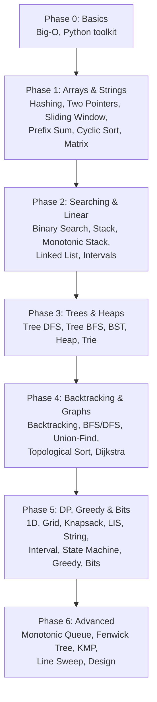

# DSA Guide: Top 1% Track (Python)

A complete roadmap of the **35 patterns** behind most coding interview questions at large tech companies (Google, Meta, Amazon, Microsoft, Apple, and others).

For every pattern you get:
1. **The idea** in plain words, with a real-life analogy.
2. **How to spot it** in a question.
3. **A Python template** with a comment above every line. Every template was run, and the outputs shown are real.
4. **The one trap** that catches most people.
5. **LeetCode questions sorted Easy → Medium → Hard**, each with a one-line hint.

**354 unique LeetCode questions:** 75 Easy · 194 Medium · 85 Hard · 187 marked ★ must-do.

---

## The Roadmap

| Phase | File | Patterns | Time |
|---|---|---|---|
| 0 | [Basics](00-basics.md) | Big-O, Python toolkit, how to attack a problem | 3 days |
| 1 | [Arrays & Strings](01-arrays-and-strings.md) | 1 Hashing · 2 Two Pointers · 3 Sliding Window · 4 Prefix Sum · 5 Cyclic Sort · 6 Matrix | 2 weeks |
| 2 | [Searching & Linear](02-searching-and-linear.md) | 7 Binary Search · 8 Stack · 9 Monotonic Stack · 10 Linked List · 11 Intervals | 2 weeks |
| 3 | [Trees & Heaps](03-trees-and-heaps.md) | 12 Tree DFS · 13 Tree BFS · 14 BST · 15 Heap / Top-K · 16 Trie | 2 weeks |
| 4 | [Backtracking & Graphs](04-recursion-and-graphs.md) | 17 Backtracking · 18 Graph BFS/DFS · 19 Union-Find · 20 Topological Sort · 21 Shortest Path & MST | 2.5 weeks |
| 5 | [DP, Greedy & Bits](05-dp-and-greedy.md) | 22 1D DP · 23 Grid DP · 24 Knapsack · 25 LIS · 26 String DP · 27 Interval DP · 28 State Machine DP · 29 Greedy · 30 Bits | 3 weeks |
| 6 | [Advanced](06-advanced.md) | 31 Monotonic Queue · 32 Fenwick / Segment Tree · 33 KMP & Rolling Hash · 34 Line Sweep · 35 Design | 1 week |

**Total: about 14 weeks at 2–3 hours a day.**

---

## How to use this guide

For each pattern:

1. **Read** the idea and the trap.
2. **Type the template yourself** from memory. Don't copy-paste. Run it.
3. **Solve the Easy questions** to lock in the template.
4. **Solve the ★ Medium questions.** Most real interview questions are Medium.
5. **Try 1–2 Hard questions** once the Mediums feel normal.
6. **Revisit** every question you needed a hint for after 3 days, then after 7 days.

Rules that make the difference:
- **Time-box:** 25 minutes on a Medium. Stuck? Read only the hint column. Still stuck at 40 minutes? Read a solution, then re-solve it the next day **without looking**.
- **Say it out loud:** explain your approach and its Big-O before coding, like in a real interview.
- **Track it:** keep a list of questions you failed and why (wrong pattern? bug? edge case?).

### Legend

| Mark | Meaning |
|---|---|
| ★ | Must-do classic. If short on time, do only these. |
| (Premium) | Needs LeetCode Premium. The same problem is often free on [LintCode](https://www.lintcode.com/) or [NeetCode](https://neetcode.io/). |

---

## Spot-the-pattern cheat sheet

Read the question, find the clue, try the pattern.

| If the question says… | Try first |
|---|---|
| sorted array, find a pair / triplet | [Two Pointers](01-arrays-and-strings.md#pattern-2-two-pointers) |
| sorted array, find a value / position | [Binary Search](02-searching-and-linear.md#pattern-7-binary-search) |
| "minimum X such that…", "maximum X such that…" | [Binary Search on the answer](02-searching-and-linear.md#pattern-7-binary-search) |
| longest / shortest **substring or subarray** with a rule | [Sliding Window](01-arrays-and-strings.md#pattern-3-sliding-window) |
| subarray sum = K (negatives allowed), range sums | [Prefix Sum + Hashing](01-arrays-and-strings.md#pattern-4-prefix-sum) |
| "have I seen…", count, duplicates, anagrams | [Hashing](01-arrays-and-strings.md#pattern-1-hashing) |
| numbers in range 1..n, missing / duplicate, O(1) space | [Cyclic Sort](01-arrays-and-strings.md#pattern-5-cyclic-sort) |
| brackets, nested structure, undo | [Stack](02-searching-and-linear.md#pattern-8-stack) |
| next greater / smaller element | [Monotonic Stack](02-searching-and-linear.md#pattern-9-monotonic-stack) |
| linked list, cycle, middle | [Fast & Slow Pointers](02-searching-and-linear.md#pattern-10-linked-list) |
| overlapping ranges, meetings | [Intervals](02-searching-and-linear.md#pattern-11-intervals) |
| tree: height, path, ancestor | [Tree DFS](03-trees-and-heaps.md#pattern-12-tree-dfs) |
| tree: by level | [Tree BFS](03-trees-and-heaps.md#pattern-13-tree-bfs) |
| top K, Kth largest, median of a stream, merge K sorted | [Heap](03-trees-and-heaps.md#pattern-15-heap--top-k) |
| prefix of words, autocomplete | [Trie](03-trees-and-heaps.md#pattern-16-trie) |
| all subsets / permutations / combinations | [Backtracking](04-recursion-and-graphs.md#pattern-17-backtracking) |
| grid islands, connected regions | [Graph DFS](04-recursion-and-graphs.md#pattern-18-graph-bfs--dfs) |
| minimum steps, all moves cost the same | [Graph BFS](04-recursion-and-graphs.md#pattern-18-graph-bfs--dfs) |
| "are these connected?", groups merging | [Union-Find](04-recursion-and-graphs.md#pattern-19-union-find-disjoint-set) |
| prerequisites, dependency order | [Topological Sort](04-recursion-and-graphs.md#pattern-20-topological-sort) |
| cheapest path, weighted edges | [Dijkstra](04-recursion-and-graphs.md#pattern-21-shortest-path--minimum-spanning-tree) |
| number of ways, min / max cost, choices affect the future | [Dynamic Programming](05-dp-and-greedy.md#the-dp-framework-read-this-first) |
| subset reaching a target sum, coins | [Knapsack](05-dp-and-greedy.md#pattern-24-knapsack) |
| two strings: common subsequence, edits | [String DP](05-dp-and-greedy.md#pattern-26-string-dp) |
| a local best choice always works | [Greedy](05-dp-and-greedy.md#pattern-29-greedy) |
| "appears once", XOR, n ≤ 20 subsets | [Bit Manipulation](05-dp-and-greedy.md#pattern-30-bit-manipulation) |
| max / min of every window | [Monotonic Queue](06-advanced.md#pattern-31-monotonic-queue) |
| range sums **with updates** | [Fenwick Tree](06-advanced.md#pattern-32-fenwick-tree--segment-tree) |
| implement a class with fast methods | [Design](06-advanced.md#pattern-35-design-questions) |

### Input size → target speed

| n up to | Target | Usually |
|---|---|---|
| 10 | O(n!) | permutations |
| 20 | O(2ⁿ) | subsets, bitmask |
| 500 | O(n³) | interval DP |
| 5,000 | O(n²) | 2D DP |
| 10⁵ – 10⁶ | O(n log n) / O(n) | sort, heap, two pointers, sliding window |
| 10⁹ | O(log n) | binary search, math |

---

## Interview day checklist

1. Repeat the problem in your own words. Ask about edge cases.
2. Do one example by hand.
3. Say the brute force and its Big-O.
4. Find the pattern (cheat sheet above). Say the better Big-O.
5. Code it with clear names.
6. Dry-run a small input line by line. Test edge cases: empty, one item, duplicates, negatives, very large.
7. State the final time and space complexity.

---

## About the code

Every template runs on Python 3.9+. Each one ends with `print(...)` calls, and the comment next to each print shows the real output.
