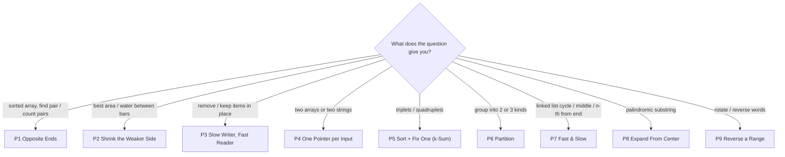

# Two Pointers in Java: All 9 Patterns

Two index variables walk through the data together. Each move throws away options that can't be the answer, so an O(n²) "try every pair" becomes O(n).

**How to practise each pattern:**
1. Read the idea and the trap below.
2. Open the template in [`patterns/`](patterns/), read it, and run it: `java P1OppositeEnds.java`.
3. Close it. Retype the template from memory in [`exercises/`](exercises/).
4. Solve Easy → Medium → Hard. ★ = must-do.

---

## P1. Opposite Ends

**Idea:** `left` at the start, `right` at the end, walk inward. Two friends search a sorted shelf from both ends: total too high, the right one steps to cheaper books. Too low, the left one steps to pricier books.

**Spot it:** sorted array + pair with a sum; palindrome; "compare from both ends".

**Template:** [P1OppositeEnds.java](patterns/P1OppositeEnds.java): A pair sum · B palindrome · C count pairs.

**The trap:** this only works on **sorted** data (or symmetric checks like palindromes). For counting, when `nums[left] + nums[right] < target`, add `right - left` pairs at once, not 1.

| Level | Questions |
|---|---|
| Easy | [344 Reverse String](https://leetcode.com/problems/reverse-string/) · [125 Valid Palindrome](https://leetcode.com/problems/valid-palindrome/) ★ · [345 Reverse Vowels of a String](https://leetcode.com/problems/reverse-vowels-of-a-string/) · [917 Reverse Only Letters](https://leetcode.com/problems/reverse-only-letters/) · [2824 Count Pairs Whose Sum is Less than Target](https://leetcode.com/problems/count-pairs-whose-sum-is-less-than-target/) · [680 Valid Palindrome II](https://leetcode.com/problems/valid-palindrome-ii/) ★ |
| Medium | [167 Two Sum II](https://leetcode.com/problems/two-sum-ii-input-array-is-sorted/) ★ · [881 Boats to Save People](https://leetcode.com/problems/boats-to-save-people/) · [1498 Number of Subsequences That Satisfy the Given Sum Condition](https://leetcode.com/problems/number-of-subsequences-that-satisfy-the-given-sum-condition/) |

## P2. Shrink the Weaker Side

**Idea:** both ends again, but each step you move the pointer that **can't get better by staying**. In Container With Most Water, the shorter wall caps the water level, so keeping it while the width shrinks can never help.

**Spot it:** "max area", "trapped water", "best pair" where a min/max of the two ends decides the score; or build a sorted answer **from the back**.

**Template:** [P2ShrinkWeakerSide.java](patterns/P2ShrinkWeakerSide.java): A max area · B trapping rain water · C sorted squares.

**The trap:** moving the **taller** wall. The area can only go down, and you miss the answer.

| Level | Questions |
|---|---|
| Easy | [977 Squares of a Sorted Array](https://leetcode.com/problems/squares-of-a-sorted-array/) ★ |
| Medium | [11 Container With Most Water](https://leetcode.com/problems/container-with-most-water/) ★ |
| Hard | [42 Trapping Rain Water](https://leetcode.com/problems/trapping-rain-water/) ★ |

## P3. Slow Writer, Fast Reader

**Idea:** `read` looks at every item once. `write` is the next slot for an item you keep. Like copying a list by hand and skipping the lines you don't want.

**Spot it:** "in place", "remove", "return the new length", "O(1) extra space".

**Template:** [P3ReadWrite.java](patterns/P3ReadWrite.java): A remove value · B keep at most k copies · C move zeroes.

**The trap:** for "at most k copies", compare with `nums[write - k]` (what you **kept**), not `nums[read - k]` (what you **read**).

| Level | Questions |
|---|---|
| Easy | [27 Remove Element](https://leetcode.com/problems/remove-element/) · [26 Remove Duplicates from Sorted Array](https://leetcode.com/problems/remove-duplicates-from-sorted-array/) ★ · [283 Move Zeroes](https://leetcode.com/problems/move-zeroes/) ★ · [1089 Duplicate Zeros](https://leetcode.com/problems/duplicate-zeros/) |
| Medium | [80 Remove Duplicates from Sorted Array II](https://leetcode.com/problems/remove-duplicates-from-sorted-array-ii/) ★ |

## P4. One Pointer per Input

**Idea:** `i` walks the first input, `j` walks the second. Move whichever one is behind. Like merging two sorted piles of exam papers into one pile.

**Spot it:** two sorted arrays, two strings, two interval lists; "merge", "subsequence", "intersection", "compare".

**Template:** [P4TwoInputs.java](patterns/P4TwoInputs.java): A merge from back · B subsequence · C common values · D interval intersections.

**The trap:** the loop stops when **one** input runs out. Ask yourself: do the leftovers of the other input still matter? In Merge Sorted Array they do; in intersection they don't.

| Level | Questions |
|---|---|
| Easy | [88 Merge Sorted Array](https://leetcode.com/problems/merge-sorted-array/) ★ · [392 Is Subsequence](https://leetcode.com/problems/is-subsequence/) ★ · [2540 Minimum Common Value](https://leetcode.com/problems/minimum-common-value/) · [349 Intersection of Two Arrays](https://leetcode.com/problems/intersection-of-two-arrays/) · [350 Intersection of Two Arrays II](https://leetcode.com/problems/intersection-of-two-arrays-ii/) · [925 Long Pressed Name](https://leetcode.com/problems/long-pressed-name/) · [844 Backspace String Compare](https://leetcode.com/problems/backspace-string-compare/) ★ |
| Medium | [986 Interval List Intersections](https://leetcode.com/problems/interval-list-intersections/) ★ · [524 Longest Word in Dictionary through Deleting](https://leetcode.com/problems/longest-word-in-dictionary-through-deleting/) · [1855 Maximum Distance Between a Pair of Values](https://leetcode.com/problems/maximum-distance-between-a-pair-of-values/) · [1813 Sentence Similarity III](https://leetcode.com/problems/sentence-similarity-iii/) |
| Hard | [1537 Get the Maximum Score](https://leetcode.com/problems/get-the-maximum-score/) |

## P5. Sort + Fix One (k-Sum)

**Idea:** sort, fix one number with a `for` loop, then run P1 on the part to its right. 3Sum = 1 loop + two pointers = O(n²).

**Spot it:** "triplets", "three numbers", "four numbers", "closest sum", "count triangles".

**Template:** [P5KSum.java](patterns/P5KSum.java): A 3Sum with no duplicates · B count triangles.

**The trap:** duplicate triplets. Skip repeated values for the fixed number **and** for left/right after a match. In 4Sum, `a + b + c + d` can overflow `int`, so use `long`.

| Level | Questions |
|---|---|
| Medium | [15 3Sum](https://leetcode.com/problems/3sum/) ★ · [16 3Sum Closest](https://leetcode.com/problems/3sum-closest/) · [611 Valid Triangle Number](https://leetcode.com/problems/valid-triangle-number/) ★ · [18 4Sum](https://leetcode.com/problems/4sum/) · [923 3Sum With Multiplicity](https://leetcode.com/problems/3sum-with-multiplicity/) · [259 3Sum Smaller](https://leetcode.com/problems/3sum-smaller/) (Premium) |

## P6. Partition

**Idea:** split an array into groups in place by swapping. Dutch National Flag uses 3 pointers: `low` (end of the 0s), `mid` (current item), `high` (start of the 2s).

**Spot it:** "only 0, 1, 2", "evens before odds", "smaller than pivot first", "in place".

**Template:** [P6Partition.java](patterns/P6Partition.java): A sort colors · B evens first.

**The trap:** after swapping with `high`, **don't** move `mid`. The item that arrived from the right hasn't been checked yet.

| Level | Questions |
|---|---|
| Easy | [905 Sort Array By Parity](https://leetcode.com/problems/sort-array-by-parity/) · [922 Sort Array By Parity II](https://leetcode.com/problems/sort-array-by-parity-ii/) |
| Medium | [75 Sort Colors](https://leetcode.com/problems/sort-colors/) ★ · [2161 Partition Array According to Given Pivot](https://leetcode.com/problems/partition-array-according-to-given-pivot/) |

## P7. Fast & Slow

**Idea:** `slow` moves 1 step, `fast` moves 2. On a circular track the fast runner always laps the slow one, so if they meet there's a loop. On a straight track, when fast finishes, slow is at the middle.

**Spot it:** linked list + "cycle", "middle", "n-th from end", "palindrome list"; or an array where values point to indexes (1..n).

**Template:** [P7FastSlow.java](patterns/P7FastSlow.java): A has cycle · B cycle start · C middle · D n-th from end · E find duplicate.

**The trap:** the loop check must be `fast != null && fast.next != null`. Check only `fast != null` and `fast.next.next` crashes with a NullPointerException.

| Level | Questions |
|---|---|
| Easy | [141 Linked List Cycle](https://leetcode.com/problems/linked-list-cycle/) ★ · [876 Middle of the Linked List](https://leetcode.com/problems/middle-of-the-linked-list/) ★ · [202 Happy Number](https://leetcode.com/problems/happy-number/) · [160 Intersection of Two Linked Lists](https://leetcode.com/problems/intersection-of-two-linked-lists/) · [234 Palindrome Linked List](https://leetcode.com/problems/palindrome-linked-list/) ★ |
| Medium | [142 Linked List Cycle II](https://leetcode.com/problems/linked-list-cycle-ii/) ★ · [19 Remove Nth Node From End of List](https://leetcode.com/problems/remove-nth-node-from-end-of-list/) ★ · [2095 Delete the Middle Node of a Linked List](https://leetcode.com/problems/delete-the-middle-node-of-a-linked-list/) · [2130 Maximum Twin Sum of a Linked List](https://leetcode.com/problems/maximum-twin-sum-of-a-linked-list/) · [143 Reorder List](https://leetcode.com/problems/reorder-list/) ★ · [287 Find the Duplicate Number](https://leetcode.com/problems/find-the-duplicate-number/) ★ · [457 Circular Array Loop](https://leetcode.com/problems/circular-array-loop/) |

## P8. Expand From the Center

**Idea:** the pointers move **away** from each other. Every palindrome has a center, either one letter (`aba`) or the gap between two (`abba`). Grow outward while the two ends match.

**Spot it:** "palindromic substring", "longest palindrome", "grow a window around index k".

**Template:** [P8ExpandFromCenter.java](patterns/P8ExpandFromCenter.java): A longest palindrome · B count palindromes.

**The trap:** checking only odd centers. `"abba"` has an **even** center, so try `expand(i, i)` and `expand(i, i + 1)` for every `i`.

| Level | Questions |
|---|---|
| Medium | [5 Longest Palindromic Substring](https://leetcode.com/problems/longest-palindromic-substring/) ★ · [647 Palindromic Substrings](https://leetcode.com/problems/palindromic-substrings/) ★ |
| Hard | [1793 Maximum Score of a Good Subarray](https://leetcode.com/problems/maximum-score-of-a-good-subarray/) |

## P9. Reverse a Range

**Idea:** `reverse(left, right)` swaps the ends and walks inward. Rotating an array or reversing words is just 2–3 reverses chained together.

**Spot it:** "rotate", "reverse words", "next permutation", "in place, O(1) space".

**Template:** [P9ReverseRange.java](patterns/P9ReverseRange.java): A rotate array · B reverse words.

**The trap:** forgetting `k = k % n`. Rotating 7 items by 10 is the same as rotating by 3, and without the `%` your indexes go out of bounds.

| Level | Questions |
|---|---|
| Easy | [541 Reverse String II](https://leetcode.com/problems/reverse-string-ii/) |
| Medium | [189 Rotate Array](https://leetcode.com/problems/rotate-array/) ★ · [151 Reverse Words in a String](https://leetcode.com/problems/reverse-words-in-a-string/) ★ · [31 Next Permutation](https://leetcode.com/problems/next-permutation/) ★ |

---

## Boss level (do these last, mixed, no pattern label)

When you can solve these cold in 40 minutes, you own two pointers.

| # | Problem | Level |
|---|---|---|
| 42 | [Trapping Rain Water](https://leetcode.com/problems/trapping-rain-water/) | Hard |
| 1537 | [Get the Maximum Score](https://leetcode.com/problems/get-the-maximum-score/) | Hard |
| 1793 | [Maximum Score of a Good Subarray](https://leetcode.com/problems/maximum-score-of-a-good-subarray/) | Hard |
| 1163 | [Last Substring in Lexicographical Order](https://leetcode.com/problems/last-substring-in-lexicographical-order/) | Hard |

**Total: 59 questions** (26 Easy · 29 Medium · 4 Hard).

Sliding Window is also a two-pointer idea, but it has its own section: [Pattern 3](../../01-arrays-and-strings.md#pattern-3-sliding-window).
