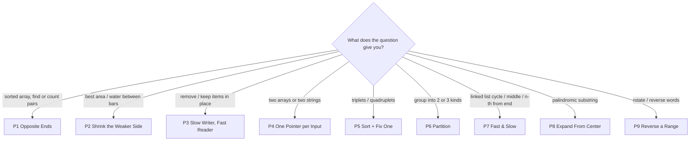

# Two Pointers in Java: Theory, Pattern Code, Questions

[← Back to the roadmap](../../README.md)

Read this file top to bottom. Each pattern has 5 parts: **How to recognise it → Theory → Dry run → Pattern code → Questions (Easy → Medium → Hard)**.
The same code is in [`patterns/`](patterns/) as files you can run, e.g. `java P1OppositeEnds.java`. Your own solutions go in [`exercises/`](exercises/).

## Contents

| # | Pattern | Pointers move | Questions |
|---|---|---|---|
| 0 | [The basics](#part-0-the-basics-read-this-first) | | |
| 1 | [Opposite Ends](#pattern-1-opposite-ends) | toward each other | 9 |
| 2 | [Shrink the Weaker Side](#pattern-2-shrink-the-weaker-side) | toward each other (greedy) | 3 |
| 3 | [Slow Writer, Fast Reader](#pattern-3-slow-writer-fast-reader) | same direction | 5 |
| 4 | [One Pointer per Input](#pattern-4-one-pointer-per-input) | one per input | 12 |
| 5 | [Sort + Fix One (k-Sum)](#pattern-5-sort--fix-one-k-sum) | loop + toward each other | 6 |
| 6 | [Partition](#pattern-6-partition) | 3 pointers / swaps | 4 |
| 7 | [Fast & Slow](#pattern-7-fast--slow) | same direction, different speed | 12 |
| 8 | [Expand From the Center](#pattern-8-expand-from-the-center) | away from each other | 3 |
| 9 | [Reverse a Range](#pattern-9-reverse-a-range) | toward each other (as a tool) | 4 |

---

## Part 0: The basics (read this first)

### What is a "pointer" here?

In these problems, a **pointer is just an `int` variable that holds an index**. It's not a C-style memory pointer. `left = 0` means "I'm looking at `nums[0]`".

```
index:   0   1   2   3   4
nums:  [ 1,  3,  4,  6,  9 ]
         ^               ^
       left            right
```

### Why two pointers?

The slow way to find a pair is to try **every** pair with a loop inside a loop. That's O(n²). With two pointers, every step throws away at least one item that can't be in the answer, so it's O(n).

I ran both in Java on 100,000 numbers (worst case: no pair exists):

| Method | Pairs checked | Time |
|---|---|---|
| Brute force, O(n²) | 4,999,950,000 | 633 ms |
| Two pointers, O(n) | 99,999 | 0.7 ms |

### Big-O in one table

| Big-O | Name | n = 100,000 means about | Typical code |
|---|---|---|---|
| O(1) | constant | 1 step | `nums[5]` |
| O(n) | linear | 100,000 steps | one loop, or two pointers |
| O(n log n) | n log n | ~1,700,000 steps | `Arrays.sort` |
| O(n²) | quadratic | 10,000,000,000 steps | loop inside a loop |

### The 4 ways two pointers move

| Movement | Picture | Patterns |
|---|---|---|
| Toward each other | `left → … ← right` | P1, P2, P5, P6, P9 |
| Same direction | `slow → … fast →` | P3, P7 |
| Away from each other | `← left right →` | P8 |
| One per input | `i →` in first, `j →` in second | P4 |

### The one question behind every pattern

> **"Which pointer can I move without losing the answer?"**

If you can explain why the item you skip can never be part of the answer, your two-pointer solution is correct. If you can't, you probably need a different pattern.

### Which pattern? (decide in 10 seconds)



### How to practise each pattern

1. Learn the **keywords** in *How to recognise it*, then read the **Theory** and say the idea out loud in your own words.
2. Do the **Dry run** on paper: same table, step by step.
3. Read the **Pattern code**, run it, then close it and **retype it from memory** in `exercises/`.
4. Solve **Easy → Medium → Hard**. ★ = must-do.
5. Stuck for 25 minutes? Read only the hint. Stuck for 40? Read a solution, then solve it again the next day **without looking**.

---

## Pattern 1: Opposite Ends

### How to recognise it

| Keyword / clue in the question | Why it points here |
|---|---|
| sorted array / "non-decreasing order" | moving a pointer has a known effect: right → smaller, left → bigger |
| "two numbers", "pair", "sum equals target" | you're looking for a pair |
| "count pairs" with sum less / greater than X | a pair count, done in one pass |
| "palindrome", "reverse", "reads the same backward" | compare the two ends |
| "O(1) extra space" + pairs | no HashMap allowed, so two pointers |

**Not this pattern if:** the array is **unsorted** and you must return the original indexes → HashMap ([1 Two Sum](https://leetcode.com/problems/two-sum/)). Contiguous "subarray / substring" → Sliding Window.

### Theory

**Idea:** put `left` on the first item and `right` on the last item. Look at the pair, decide, then move ONE of them inward. Stop when they meet.

**Analogy:** two friends stand at the two ends of a bookshelf where prices are sorted from cheap to expensive. They want two books that cost exactly 9 together. Total too high? The friend on the expensive end steps to a cheaper book. Too low? The friend on the cheap end steps to a pricier book.

**Why it's correct (the key thinking):** say `nums[left] + nums[right]` is **too big**. Every pair that uses `right` and something from `left` onward is at least as big (the array is sorted), so `right` can never be in the answer. Throw it away: `right--`. The same logic works for too small → `left++`. Every step safely throws away one item, so there are at most n steps.

**Complexity:** time O(n) (plus O(n log n) if you must sort first), space O(1).

### Dry run

`pairWithSum([1, 3, 4, 6, 9], 9)`:

| left | right | sum | action |
|---|---|---|---|
| 0 | 4 | 1 + 9 = 10 | too big → right-- |
| 0 | 3 | 1 + 6 = 7 | too small → left++ |
| 1 | 3 | 3 + 6 = 9 | equal → answer [1, 3] |

### Pattern code

Runnable file: [`patterns/P1OppositeEnds.java`](patterns/P1OppositeEnds.java)

**Template A: pair with a given sum (sorted array)**

```java
// Template A: find two numbers in a SORTED array that add up to target.
// Returns their indexes, or [-1, -1] if no pair exists.
// Time O(n), space O(1).
static int[] pairWithSum(int[] sortedNums, int target) {
    // left starts at the smallest number
    int left = 0;
    // right starts at the biggest number
    int right = sortedNums.length - 1;
    // stop when the two pointers meet (a number can't pair with itself)
    while (left < right) {
        // add the two numbers the pointers are on
        int sum = sortedNums[left] + sortedNums[right];
        // found the pair
        if (sum == target) {
            return new int[] {left, right};
        }
        // sum too small: the only way to grow it is a bigger left number
        if (sum < target) {
            left++;
        } else {
            // sum too big: the only way to shrink it is a smaller right number
            right--;
        }
    }
    // pointers met without finding a pair
    return new int[] {-1, -1};
}
```

**Template B: palindrome check (skip non-letters)**

```java
// Template B: is the string a palindrome, ignoring non-letters/digits and case?
// Time O(n), space O(1).
static boolean isPalindrome(String text) {
    // pointer at the first character
    int left = 0;
    // pointer at the last character
    int right = text.length() - 1;
    // compare until the pointers meet
    while (left < right) {
        // skip anything on the left that is not a letter or digit
        if (!Character.isLetterOrDigit(text.charAt(left))) {
            left++;
            continue;
        }
        // skip anything on the right that is not a letter or digit
        if (!Character.isLetterOrDigit(text.charAt(right))) {
            right--;
            continue;
        }
        // lower-case both so 'A' and 'a' count as the same
        char leftChar = Character.toLowerCase(text.charAt(left));
        char rightChar = Character.toLowerCase(text.charAt(right));
        // one mismatch is enough to say "not a palindrome"
        if (leftChar != rightChar) {
            return false;
        }
        // both matched: move both pointers inward
        left++;
        right--;
    }
    // every pair matched
    return true;
}
```

**Template C: count pairs with sum < target**

```java
// Template C: COUNT pairs in a SORTED array whose sum is less than target.
// Key trick: if nums[left] + nums[right] < target, then left pairs with
// EVERY index from left+1 up to right. That is (right - left) pairs at once.
// Time O(n), space O(1).
static int countPairsLessThan(int[] sortedNums, int target) {
    // pointer at the smallest number
    int left = 0;
    // pointer at the biggest number
    int right = sortedNums.length - 1;
    // running total of valid pairs
    int count = 0;
    // stop when the pointers meet
    while (left < right) {
        // sum of the current pair
        int sum = sortedNums[left] + sortedNums[right];
        if (sum < target) {
            // left + any number between left and right is also < target
            count = count + (right - left);
            // left is fully counted: move on
            left++;
        } else {
            // sum too big: try a smaller right number
            right--;
        }
    }
    // total pairs found
    return count;
}
```

### The one trap

Two Pointers needs **sorted** data (or a symmetric check like a palindrome). On an unsorted array, `sum too big → right--` isn't guaranteed to be safe anymore. When **counting**, if `nums[left] + nums[right] < target`, then `left` works with every index from `left + 1` to `right`, so add `right - left` at once, not 1.

### Questions

**Easy**

| # | Problem | Hint |
|---|---|---|
| 344 | [Reverse String](https://leetcode.com/problems/reverse-string/) | Swap ends, walk inward |
| 125 | [Valid Palindrome](https://leetcode.com/problems/valid-palindrome/) ★ | Template B |
| 345 | [Reverse Vowels of a String](https://leetcode.com/problems/reverse-vowels-of-a-string/) | Skip non-vowels on both sides, then swap |
| 917 | [Reverse Only Letters](https://leetcode.com/problems/reverse-only-letters/) | Skip non-letters on both sides, then swap |
| 2824 | [Count Pairs Whose Sum is Less than Target](https://leetcode.com/problems/count-pairs-whose-sum-is-less-than-target/) | Sort, then Template C |
| 680 | [Valid Palindrome II](https://leetcode.com/problems/valid-palindrome-ii/) ★ | On first mismatch, try skipping left OR right once |

**Medium**

| # | Problem | Hint |
|---|---|---|
| 167 | [Two Sum II - Input Array Is Sorted](https://leetcode.com/problems/two-sum-ii-input-array-is-sorted/) ★ | Template A (answer is 1-indexed) |
| 881 | [Boats to Save People](https://leetcode.com/problems/boats-to-save-people/) | Sort; heaviest shares a boat with lightest if they fit |
| 1498 | [Number of Subsequences That Satisfy the Given Sum Condition](https://leetcode.com/problems/number-of-subsequences-that-satisfy-the-given-sum-condition/) | Sort; if min+max fits, add 2^(right-left) ways |

---

## Pattern 2: Shrink the Weaker Side

### How to recognise it

| Keyword / clue in the question | Why it points here |
|---|---|
| "maximum area", "most water", "container" | score = min of the two ends × distance |
| "trap rain water", "bars", "elevation map" | each bar is limited by the max on its left and right |
| "squares of a sorted array", sorted with negatives | the biggest values are at the two ends, so fill from the back |

**Not this pattern if:** you need the next greater / smaller bar for **every** item → Monotonic Stack.

### Theory

**Idea:** same start as Pattern 1 (both ends), but there's no exact target. You're looking for the **best** score. Each step, move the pointer that **can't do better by staying**.

**Analogy:** a tank built from two walls holds water only up to the **shorter** wall. If you keep the short wall and move the tall one inward, the width shrinks and the height is still capped by the same short wall, so the water can only go down. So you move the short wall and hope to find a taller one.

**Why it's correct:** area = `min(h[left], h[right]) × (right - left)`. If `h[left]` is the shorter one, every other pair using `left` has a smaller width and a height ≤ `h[left]`. None of them can beat the area you just measured, so `left` is finished: `left++`.

**Variant: fill from the back.** In "Squares of a Sorted Array", the biggest square is always at one of the two ends (big negatives or big positives). Compare the two ends and write the bigger one into the **last** free slot.

**Complexity:** time O(n), space O(1) (O(n) when you build a new answer array).

### Dry run

`maxArea([1, 8, 6, 2, 5, 4, 8, 3, 7])`:

| left | right | h[left] | h[right] | area | best | move |
|---|---|---|---|---|---|---|
| 0 | 8 | 1 | 7 | 1 × 8 = 8 | 8 | left++ (left is shorter) |
| 1 | 8 | 8 | 7 | 7 × 7 = 49 | 49 | right-- (right is shorter or equal) |
| 1 | 7 | 8 | 3 | 3 × 6 = 18 | 49 | right-- (right is shorter or equal) |
| 1 | 6 | 8 | 8 | 8 × 5 = 40 | 49 | right-- (right is shorter or equal) |

…every later step has `right` as the shorter wall, and no area beats **49**. Answer: **49**.

### Pattern code

Runnable file: [`patterns/P2ShrinkWeakerSide.java`](patterns/P2ShrinkWeakerSide.java)

**Template A: Container With Most Water**

```java
// Template A: Container With Most Water (LeetCode 11).
// Area between two walls = shorter wall * distance between them.
// Time O(n), space O(1).
static int maxArea(int[] heights) {
    // left wall
    int left = 0;
    // right wall
    int right = heights.length - 1;
    // best area seen so far
    int best = 0;
    // try walls until they meet
    while (left < right) {
        // distance between the two walls
        int width = right - left;
        // water level is limited by the shorter wall
        int shorter = Math.min(heights[left], heights[right]);
        // area for this pair of walls
        int area = shorter * width;
        // keep the biggest
        best = Math.max(best, area);
        // the shorter wall can never give a bigger area with a smaller width, so move it
        if (heights[left] < heights[right]) {
            left++;
        } else {
            right--;
        }
    }
    // biggest area found
    return best;
}
```

**Template B: Trapping Rain Water**

```java
// Template B: Trapping Rain Water (LeetCode 42).
// Water above a bar = min(tallest bar on its left, tallest bar on its right) - its height.
// Time O(n), space O(1).
static int trap(int[] heights) {
    // pointer from the left
    int left = 0;
    // pointer from the right
    int right = heights.length - 1;
    // tallest bar seen so far from the left side
    int leftMax = 0;
    // tallest bar seen so far from the right side
    int rightMax = 0;
    // total trapped water
    int water = 0;
    // process bars until the pointers meet
    while (left < right) {
        // the side with the smaller bar is limited by its own max: we can settle it now
        if (heights[left] < heights[right]) {
            // update the tallest bar on the left
            leftMax = Math.max(leftMax, heights[left]);
            // water above this bar (0 if it is the new tallest)
            water = water + (leftMax - heights[left]);
            // this bar is done
            left++;
        } else {
            // update the tallest bar on the right
            rightMax = Math.max(rightMax, heights[right]);
            // water above this bar
            water = water + (rightMax - heights[right]);
            // this bar is done
            right--;
        }
    }
    // total water
    return water;
}
```

**Template C: Squares of a Sorted Array (fill from the back)**

```java
// Template C: Squares of a Sorted Array (LeetCode 977). Fill the answer from the BACK.
// With negatives, the biggest square is always at one of the two ends.
// Time O(n), space O(n) for the answer.
static int[] sortedSquares(int[] sortedNums) {
    // number of items
    int n = sortedNums.length;
    // answer array
    int[] result = new int[n];
    // pointer at the left end
    int left = 0;
    // pointer at the right end
    int right = n - 1;
    // fill the answer from the last slot to the first
    for (int write = n - 1; write >= 0; write--) {
        // square of the left number
        int leftSquare = sortedNums[left] * sortedNums[left];
        // square of the right number
        int rightSquare = sortedNums[right] * sortedNums[right];
        // the bigger square goes in the current last slot
        if (leftSquare > rightSquare) {
            result[write] = leftSquare;
            left++;
        } else {
            result[write] = rightSquare;
            right--;
        }
    }
    // squares in sorted order
    return result;
}
```

### The one trap

Moving the **taller** wall. The area can only go down, and you miss the answer. In Trapping Rain Water, settle the side whose bar is **smaller**: that side's water depends only on its own running max.

### Questions

**Easy**

| # | Problem | Hint |
|---|---|---|
| 977 | [Squares of a Sorted Array](https://leetcode.com/problems/squares-of-a-sorted-array/) ★ | Template C: bigger square goes to the back |

**Medium**

| # | Problem | Hint |
|---|---|---|
| 11 | [Container With Most Water](https://leetcode.com/problems/container-with-most-water/) ★ | Template A: move the shorter wall |

**Hard**

| # | Problem | Hint |
|---|---|---|
| 42 | [Trapping Rain Water](https://leetcode.com/problems/trapping-rain-water/) ★ | Template B: water = sideMax − height |

---

## Pattern 3: Slow Writer, Fast Reader

### How to recognise it

| Keyword / clue in the question | Why it points here |
|---|---|
| "in place" | you can't build a new array |
| "O(1) extra memory" | only index variables allowed |
| "remove", "delete", "return k / the new length" | keep some items, drop the rest |
| "remove duplicates" in a **sorted** array | copies sit next to each other |
| "move all X to the end", "keep the relative order" | a stable write pointer |

**Not this pattern if:** you need counts of values that are spread out in an **unsorted** array → HashMap.

### Theory

**Idea:** both pointers move in the **same direction**. `read` visits every item once. `write` points at the next free slot for an item you want to **keep**. Everything before `write` is your finished answer.

**Analogy:** copying a shopping list onto a fresh page and skipping the items you already bought. Your eyes (`read`) go through every line; your pen (`write`) only moves when you copy something.

**Why it works:** `write` never gets ahead of `read`, so you never overwrite an item you haven't read yet. That's why it works **in place** with O(1) extra space.

**Complexity:** time O(n), space O(1).

### Dry run

`keepAtMostK([1, 1, 2, 3, 3], 1)`:

| read | value | decision | write after | kept part |
|---|---|---|---|---|
| 0 | 1 | keep | 1 | [1] |
| 1 | 1 | skip (copy) | 1 | [1] |
| 2 | 2 | keep | 2 | [1, 2] |
| 3 | 3 | keep | 3 | [1, 2, 3] |
| 4 | 3 | skip (copy) | 3 | [1, 2, 3] |

### Pattern code

Runnable file: [`patterns/P3ReadWrite.java`](patterns/P3ReadWrite.java)

**Template A: remove every copy of a value**

```java
// Template A: remove every copy of value, in place (LeetCode 27).
// Returns how many items are kept. Time O(n), space O(1).
static int removeElement(int[] nums, int value) {
    // next free slot for a kept item
    int write = 0;
    // look at every item once
    for (int read = 0; read < nums.length; read++) {
        // keep anything that is not the value to remove
        if (nums[read] != value) {
            // copy it into the next free slot
            nums[write] = nums[read];
            // the free slot moves forward
            write++;
        }
    }
    // number of kept items
    return write;
}
```

**Template B: keep each value at most k times (sorted)**

```java
// Template B: in a SORTED array, keep each value at most k times (LeetCode 26 is k=1, LeetCode 80 is k=2).
// Returns how many items are kept. Time O(n), space O(1).
static int keepAtMostK(int[] sortedNums, int k) {
    // next free slot for a kept item
    int write = 0;
    // look at every item once
    for (int read = 0; read < sortedNums.length; read++) {
        // the first k items are always kept
        boolean isEarly = write < k;
        // if this value differs from the one k slots back, it has fewer than k copies so far
        boolean isNotTooMany = isEarly || sortedNums[read] != sortedNums[write - k];
        if (isNotTooMany) {
            // keep it
            sortedNums[write] = sortedNums[read];
            write++;
        }
    }
    // number of kept items
    return write;
}
```

**Template C: move zeroes to the end (swap)**

```java
// Template C: move all zeroes to the end, keeping the order of the others (LeetCode 283).
// SWAP instead of copy, so the zeroes end up at the back by themselves.
// Time O(n), space O(1).
static void moveZeroes(int[] nums) {
    // next slot for a non-zero number
    int write = 0;
    // look at every item once
    for (int read = 0; read < nums.length; read++) {
        // a non-zero number goes to the front part
        if (nums[read] != 0) {
            // swap it with whatever is at the write slot (a zero, or itself)
            int temp = nums[write];
            nums[write] = nums[read];
            nums[read] = temp;
            // the front part grew by one
            write++;
        }
    }
}
```

### The one trap

For "at most k copies", compare with `nums[write - k]` (what you've **kept**), not `nums[read - k]` (what you've **read**). The kept part is the one that's correct.

### Questions

**Easy**

| # | Problem | Hint |
|---|---|---|
| 27 | [Remove Element](https://leetcode.com/problems/remove-element/) | Template A |
| 26 | [Remove Duplicates from Sorted Array](https://leetcode.com/problems/remove-duplicates-from-sorted-array/) ★ | Template B with k = 1 |
| 283 | [Move Zeroes](https://leetcode.com/problems/move-zeroes/) ★ | Template C (swap, don't copy) |
| 1089 | [Duplicate Zeros](https://leetcode.com/problems/duplicate-zeros/) | Count zeros first, then write from the back |

**Medium**

| # | Problem | Hint |
|---|---|---|
| 80 | [Remove Duplicates from Sorted Array II](https://leetcode.com/problems/remove-duplicates-from-sorted-array-ii/) ★ | Template B with k = 2 |

---

## Pattern 4: One Pointer per Input

### How to recognise it

| Keyword / clue in the question | Why it points here |
|---|---|
| "two sorted arrays", "two lists" | one pointer in each |
| "merge" | take the smaller head each step |
| "is subsequence", "by deleting some characters" | match in order, skipping is allowed |
| "intersection", "common" | move the one that's behind |
| "two interval lists", "overlap" | drop the interval that ends first |
| "backspace", `#` in strings | walk both strings from the back |

**Not this pattern if:** there are **K** sorted lists (not 2) → Heap.

### Theory

**Idea:** there are **two** inputs (two arrays, two strings, two lists). Pointer `i` walks the first, pointer `j` walks the second. Each step, compare `first[i]` with `second[j]` and move the one that's **behind**.

**Analogy:** merging two sorted piles of exam papers into one sorted pile. Look at the top paper of each pile, take the smaller one, repeat.

**Why it works:** both inputs are already in order. The smaller item can't match anything later in the other input (those items are even bigger), so it's safe to move past it. Each pointer only moves forward: O(m + n).

**Variant: work from the back.** In "Merge Sorted Array", the first array has empty space at the end. Filling from the **front** would overwrite numbers you still need. Filling from the **back** (biggest first) never does.

**Complexity:** time O(m + n), space O(1) besides the answer.

### Dry run

`isSubsequence("abc", "ahbgdc")`:

| i | small[i] | j | big[j] | action |
|---|---|---|---|---|
| 0 | a | 0 | a | match → i++, j++ |
| 1 | b | 1 | h | no match → j++ |
| 1 | b | 2 | b | match → i++, j++ |
| 2 | c | 3 | g | no match → j++ |
| 2 | c | 4 | d | no match → j++ |
| 2 | c | 5 | c | match → i++, j++ |

End: i = 3 = length of small → **true**

### Pattern code

Runnable file: [`patterns/P4TwoInputs.java`](patterns/P4TwoInputs.java)

**Template A: merge two sorted arrays (fill from the back)**

```java
// Template A: merge two sorted arrays into first, which has room at the end (LeetCode 88).
// Fill from the BACK so we never overwrite a number we still need.
// Time O(m + n), space O(1).
static void mergeFromBack(int[] first, int m, int[] second, int n) {
    // last real number in first
    int i = m - 1;
    // last number in second
    int j = n - 1;
    // last slot of first (where the biggest number goes)
    int write = m + n - 1;
    // while second still has numbers to place
    while (j >= 0) {
        // first still has numbers AND its number is bigger: place it
        if (i >= 0 && first[i] > second[j]) {
            first[write] = first[i];
            i--;
        } else {
            // otherwise place the number from second
            first[write] = second[j];
            j--;
        }
        // next slot to the left
        write--;
    }
    // leftover numbers in first are already in the right place
}
```

**Template B: is subsequence**

```java
// Template B: is small a subsequence of big? (LeetCode 392)
// Subsequence = same characters in the same order, gaps allowed.
// Time O(length of big), space O(1).
static boolean isSubsequence(String small, String big) {
    // pointer in small
    int i = 0;
    // pointer in big
    int j = 0;
    // walk both until one runs out
    while (i < small.length() && j < big.length()) {
        // characters match: this char of small is found
        if (small.charAt(i) == big.charAt(j)) {
            i++;
        }
        // always move forward in big
        j++;
    }
    // true if every character of small was found
    return i == small.length();
}
```

**Template C: common values of two sorted arrays**

```java
// Template C: common values of two SORTED arrays, keeping repeats (LeetCode 350 after sorting).
// Time O(m + n), space O(1) besides the answer.
static List<Integer> commonValues(int[] first, int[] second) {
    // answer list
    List<Integer> result = new ArrayList<>();
    // pointer in first
    int i = 0;
    // pointer in second
    int j = 0;
    // stop when either array runs out
    while (i < first.length && j < second.length) {
        if (first[i] == second[j]) {
            // same value in both: keep it, move both
            result.add(first[i]);
            i++;
            j++;
        } else if (first[i] < second[j]) {
            // first is behind: move it forward
            i++;
        } else {
            // second is behind: move it forward
            j++;
        }
    }
    // all common values
    return result;
}
```

**Template D: interval list intersections**

```java
// Template D: intersections of two sorted lists of intervals (LeetCode 986).
// Time O(m + n), space O(1) besides the answer.
static List<int[]> intervalIntersections(int[][] first, int[][] second) {
    // answer list
    List<int[]> result = new ArrayList<>();
    // pointer in first
    int i = 0;
    // pointer in second
    int j = 0;
    // stop when either list runs out
    while (i < first.length && j < second.length) {
        // overlap starts at the later start
        int start = Math.max(first[i][0], second[j][0]);
        // overlap ends at the earlier end
        int end = Math.min(first[i][1], second[j][1]);
        // a real overlap exists
        if (start <= end) {
            result.add(new int[] {start, end});
        }
        // the interval that ends first cannot overlap anything else: move past it
        if (first[i][1] < second[j][1]) {
            i++;
        } else {
            j++;
        }
    }
    // all overlaps
    return result;
}
```

### The one trap

The loop stops when **one** input runs out. Always ask: do the leftovers of the other input still matter? In Merge Sorted Array they do (loop on `j >= 0`). In intersection they don't.

### Questions

**Easy**

| # | Problem | Hint |
|---|---|---|
| 88 | [Merge Sorted Array](https://leetcode.com/problems/merge-sorted-array/) ★ | Template A: fill from the back |
| 392 | [Is Subsequence](https://leetcode.com/problems/is-subsequence/) ★ | Template B |
| 2540 | [Minimum Common Value](https://leetcode.com/problems/minimum-common-value/) | Template C, return the first match |
| 349 | [Intersection of Two Arrays](https://leetcode.com/problems/intersection-of-two-arrays/) | Sort both, Template C, skip repeats |
| 350 | [Intersection of Two Arrays II](https://leetcode.com/problems/intersection-of-two-arrays-ii/) | Sort both, Template C |
| 925 | [Long Pressed Name](https://leetcode.com/problems/long-pressed-name/) | Match, or skip a repeat of the previous typed char |
| 844 | [Backspace String Compare](https://leetcode.com/problems/backspace-string-compare/) ★ | Walk both strings from the BACK, skip chars eaten by # |

**Medium**

| # | Problem | Hint |
|---|---|---|
| 986 | [Interval List Intersections](https://leetcode.com/problems/interval-list-intersections/) ★ | Template D |
| 524 | [Longest Word in Dictionary through Deleting](https://leetcode.com/problems/longest-word-in-dictionary-through-deleting/) | Template B for each word |
| 1855 | [Maximum Distance Between a Pair of Values](https://leetcode.com/problems/maximum-distance-between-a-pair-of-values/) | Both non-increasing; move j while valid, else i |
| 1813 | [Sentence Similarity III](https://leetcode.com/problems/sentence-similarity-iii/) | Match words from the front, then from the back |

**Hard**

| # | Problem | Hint |
|---|---|---|
| 1537 | [Get the Maximum Score](https://leetcode.com/problems/get-the-maximum-score/) | Sum each segment; at a common value take the bigger segment sum |

---

## Pattern 5: Sort + Fix One (k-Sum)

### How to recognise it

| Keyword / clue in the question | Why it points here |
|---|---|
| "triplets", "three numbers", "3Sum" | 1 loop + two pointers |
| "four numbers", "4Sum" | 2 loops + two pointers |
| "closest to target" | same as 3Sum, and track the best distance |
| "unique" / "no duplicate triplets" | sort, then skip repeated values |
| "triangle", "a + b > c" | fix the biggest side, count pairs |

**Not this pattern if:** you need a contiguous subarray sum → Prefix Sum or Sliding Window.

### Theory

**Idea:** to find **three** numbers, sort the array, fix the first number with a `for` loop, and then run Pattern 1 (opposite ends) on the part to its right to find the other two.

**Analogy:** picking a team of three whose ages add up to 30. Pick person #1. Now the problem is "find two people whose ages add up to 30 − age #1", and you already know how to do that.

**How the cost grows:**

| Problem | Loops | + two pointers | Total |
|---|---|---|---|
| 2Sum (sorted) | 0 | O(n) | O(n) |
| 3Sum | 1 | O(n) | O(n²) |
| 4Sum | 2 | O(n) | O(n³) |

**Counting variant:** in "Valid Triangle Number", fix the **biggest** side from the right. Then `a + b > biggest` is a pair-count problem: when it works for `left`, it also works for every index between `left` and `right`, so add `right - left`.

**Complexity:** 3Sum: time O(n²), space O(1) besides the answer.

### Dry run

`threeSum([-1, 0, 1, 2, -1, -4])`.

Sorted: `[-4, -1, -1, 0, 1, 2]`. Fixed `first = 1` (value `-1`):

| left | right | sum | action |
|---|---|---|---|
| 2 | 5 | -1 + -1 + 2 = 0 | save → move both, skip copies |
| 3 | 4 | -1 + 0 + 1 = 0 | save → move both, skip copies |

### Pattern code

Runnable file: [`patterns/P5KSum.java`](patterns/P5KSum.java)

**Template A: 3Sum, unique triplets**

```java
// Template A: all UNIQUE triplets that sum to 0 (LeetCode 15).
// Time O(n^2), space O(1) besides the answer (sorting aside).
static List<List<Integer>> threeSum(int[] nums) {
    // sorting makes two pointers possible and puts duplicates next to each other
    Arrays.sort(nums);
    // answer list
    List<List<Integer>> result = new ArrayList<>();
    // fix the first number of the triplet
    for (int first = 0; first < nums.length - 2; first++) {
        // same first value as last time would give the same triplets: skip it
        if (first > 0 && nums[first] == nums[first - 1]) {
            continue;
        }
        // two pointers on the part to the right of first
        int left = first + 1;
        int right = nums.length - 1;
        while (left < right) {
            // sum of the three numbers
            int sum = nums[first] + nums[left] + nums[right];
            if (sum == 0) {
                // found one: save it
                result.add(Arrays.asList(nums[first], nums[left], nums[right]));
                // move both pointers inward
                left++;
                right--;
                // skip copies of the left value we just used
                while (left < right && nums[left] == nums[left - 1]) {
                    left++;
                }
                // skip copies of the right value we just used
                while (left < right && nums[right] == nums[right + 1]) {
                    right--;
                }
            } else if (sum < 0) {
                // too small: need a bigger number
                left++;
            } else {
                // too big: need a smaller number
                right--;
            }
        }
    }
    // all unique triplets
    return result;
}
```

**Template B: count triangles (fix the biggest side)**

```java
// Template B: COUNT triplets that can form a triangle (LeetCode 611).
// Fix the BIGGEST side from the right. Then a + b > biggest is a pair-count problem.
// Time O(n^2), space O(1).
static int triangleCount(int[] sides) {
    // sort so the biggest side is on the right
    Arrays.sort(sides);
    // running total
    int count = 0;
    // fix the biggest side, moving from the right end down
    for (int biggest = sides.length - 1; biggest >= 2; biggest--) {
        // two pointers on the part to the left of biggest
        int left = 0;
        int right = biggest - 1;
        while (left < right) {
            if (sides[left] + sides[right] > sides[biggest]) {
                // works for left, and for every index between left and right too
                count = count + (right - left);
                // right is fully counted: move it
                right--;
            } else {
                // too small: need a bigger left side
                left++;
            }
        }
    }
    // total triangles
    return count;
}
```

### The one trap

Duplicate triplets. Skip repeated values for the **fixed** number, and for **left/right after a match**. In 4Sum, `a + b + c + d` can be bigger than an `int` can hold, so add them as `long`.

### Questions

**Medium**

| # | Problem | Hint |
|---|---|---|
| 15 | [3Sum](https://leetcode.com/problems/3sum/) ★ | Template A |
| 16 | [3Sum Closest](https://leetcode.com/problems/3sum-closest/) | Template A, track the smallest |sum − target| |
| 611 | [Valid Triangle Number](https://leetcode.com/problems/valid-triangle-number/) ★ | Template B |
| 18 | [4Sum](https://leetcode.com/problems/4sum/) | Two loops + Template A, use long |
| 923 | [3Sum With Multiplicity](https://leetcode.com/problems/3sum-with-multiplicity/) | Count combos when values repeat; mod 1e9+7 |
| 259 | [3Sum Smaller](https://leetcode.com/problems/3sum-smaller/) (Premium) | Sort; when sum < target add right − left |

---

## Pattern 6: Partition

### How to recognise it

| Keyword / clue in the question | Why it points here |
|---|---|
| "only 0, 1 and 2", "sort colors" | Dutch National Flag, 3 pointers |
| "one pass", "in place", "without a sort function" | partition by swapping |
| "evens before odds", "by parity" | 2-group partition |
| "less than pivot first, then equal, then greater" | 3-group partition |

**Not this pattern if:** the values can be anything and you need full sorted order → just sort.

### Theory

**Idea:** rearrange the array **in place** into groups (all 0s, then 1s, then 2s; or evens, then odds) by swapping. No extra array.

**Dutch National Flag (3 pointers):** the array has four zones at all times:

| Zone | Range | Holds |
|---|---|---|
| done 0s | `0 .. low-1` | only 0 |
| done 1s | `low .. mid-1` | only 1 |
| unknown | `mid .. high` | not looked at yet |
| done 2s | `high+1 .. end` | only 2 |

Look at `nums[mid]`: a 0 is swapped into the 0-zone, a 1 stays, a 2 is swapped into the 2-zone. The unknown zone shrinks by one every step.

**Analogy:** sorting laundry into three baskets in a single pass: whites go to the left basket, darks to the right, everything else stays in the middle.

**Complexity:** time O(n) single pass, space O(1).

### Dry run

`sortColors([2, 0, 2, 1, 1, 0])`:

| low | mid | high | nums[mid] | action | array after |
|---|---|---|---|---|---|
| 0 | 0 | 5 | 2 | 2 → swap(mid, high), high-- | [0, 0, 2, 1, 1, 2] |
| 0 | 0 | 4 | 0 | 0 → swap(low, mid), low++, mid++ | [0, 0, 2, 1, 1, 2] |
| 1 | 1 | 4 | 0 | 0 → swap(low, mid), low++, mid++ | [0, 0, 2, 1, 1, 2] |
| 2 | 2 | 4 | 2 | 2 → swap(mid, high), high-- | [0, 0, 1, 1, 2, 2] |
| 2 | 2 | 3 | 1 | 1 → mid++ | [0, 0, 1, 1, 2, 2] |
| 2 | 3 | 3 | 1 | 1 → mid++ | [0, 0, 1, 1, 2, 2] |

### Pattern code

Runnable file: [`patterns/P6Partition.java`](patterns/P6Partition.java)

**Helper: swap**

```java
// small helper: swap two items of an array
static void swap(int[] nums, int a, int b) {
    // remember the first item
    int temp = nums[a];
    // overwrite the first with the second
    nums[a] = nums[b];
    // put the remembered first into the second's place
    nums[b] = temp;
}
```

**Template A: Dutch National Flag (sort 0s, 1s, 2s)**

```java
// Template A: sort an array of only 0s, 1s and 2s in ONE pass (LeetCode 75).
// Time O(n), space O(1).
static void sortColors(int[] nums) {
    // everything before low is 0
    int low = 0;
    // the item we are looking at
    int mid = 0;
    // everything after high is 2
    int high = nums.length - 1;
    // items between mid and high are not looked at yet
    while (mid <= high) {
        if (nums[mid] == 0) {
            // a 0 belongs at the front: swap it into the 0s group
            swap(nums, low, mid);
            // both groups grew; the item swapped in is a 1 (already checked), so mid moves too
            low++;
            mid++;
        } else if (nums[mid] == 1) {
            // a 1 is already in the middle group
            mid++;
        } else {
            // a 2 belongs at the back: swap it into the 2s group
            swap(nums, mid, high);
            // the 2s group grew; do NOT move mid, the item swapped in is not checked yet
            high--;
        }
    }
}
```

**Template B: evens first (opposite-ends partition)**

```java
// Template B: evens first, then odds (LeetCode 905). Opposite ends partition.
// Time O(n), space O(1).
static void evensFirst(int[] nums) {
    // looks for an odd number on the left side
    int left = 0;
    // looks for an even number on the right side
    int right = nums.length - 1;
    while (left < right) {
        if (nums[left] % 2 == 0) {
            // left is already even: fine, move on
            left++;
        } else if (nums[right] % 2 == 1) {
            // right is already odd: fine, move on
            right--;
        } else {
            // left is odd and right is even: swap them
            swap(nums, left, right);
            left++;
            right--;
        }
    }
}
```

### The one trap

After swapping with `high`, **don't** move `mid`. The item that just arrived from the right hasn't been checked yet. (After swapping with `low` you can move `mid`, because that item is a 1 you already checked.)

### Questions

**Easy**

| # | Problem | Hint |
|---|---|---|
| 905 | [Sort Array By Parity](https://leetcode.com/problems/sort-array-by-parity/) | Template B |
| 922 | [Sort Array By Parity II](https://leetcode.com/problems/sort-array-by-parity-ii/) | Even pointer on even indexes, odd pointer on odd indexes |

**Medium**

| # | Problem | Hint |
|---|---|---|
| 75 | [Sort Colors](https://leetcode.com/problems/sort-colors/) ★ | Template A |
| 2161 | [Partition Array According to Given Pivot](https://leetcode.com/problems/partition-array-according-to-given-pivot/) | Keep relative order: fill smaller / equal / bigger in order |

---

## Pattern 7: Fast & Slow

### How to recognise it

| Keyword / clue in the question | Why it points here |
|---|---|
| "linked list" + "cycle" / "loop" | fast catches slow |
| "middle of the linked list" | fast ends when slow is halfway |
| "n-th node from the end" | same speed with a fixed gap |
| "palindrome linked list", "reorder list" | find the middle, then reverse half |
| "n + 1 numbers in range 1..n", "don't modify the array", "O(1) space" | values act as next pointers, and the duplicate is the cycle start |
| "repeats endlessly", "loops forever" (Happy Number) | cycle detection on a sequence of numbers |

**Not this pattern if:** you need the k-th item from the **start** of an array → just use the index.

### Theory

**Idea:** two pointers move along the same path at **different speeds**: `slow` takes 1 step, `fast` takes 2 steps.

**Analogy:** two runners on a track. On a **circular** track the fast runner always laps the slow one, so they meet. On a **straight** track the fast runner reaches the finish first, and at that moment the slow runner is exactly halfway.

**Three things it tells you:**

| Question | How |
|---|---|
| Is there a loop? | If `slow == fast` at some point, yes. If `fast` hits `null`, no. |
| Where is the middle? | When `fast` reaches the end, `slow` is in the middle. |
| Where does the loop start? | After they meet, send one pointer back to the head. Move both 1 step; they meet at the loop start (Floyd's algorithm). |

**Gap variant (same speed):** for "n-th node from the end", move `ahead` n+1 steps first, then move both together. When `ahead` falls off the end, `behind` is right before the node to remove.

**Array variant:** if an array has n+1 numbers in range 1..n, treat each value as "go to this index next". That forms a linked list with a loop, and the loop start is the duplicate number.

**Complexity:** time O(n), space O(1).

### Dry run

`middle(1 -> 2 -> 3 -> 4 -> 5)`:

| step | slow on | fast on |
|---|---|---|
| start | 1 | 1 |
| 1 | 2 | 3 |
| 2 | 3 | 5 |

fast is on the last node (`fast.next == null`) → stop. slow = **3** = middle.

### Pattern code

Runnable file: [`patterns/P7FastSlow.java`](patterns/P7FastSlow.java)

**Helper: linked list node**

```java
// a linked list node: a value plus a link to the next node
static class ListNode {
    // the number stored in this node
    int val;
    // the next node in the list (null at the end)
    ListNode next;

    // constructor: make a node holding val
    ListNode(int val) {
        this.val = val;
    }
}
```

**Template A: has cycle**

```java
// Template A: does the list have a cycle? (LeetCode 141). Time O(n), space O(1).
static boolean hasCycle(ListNode head) {
    // both start at the head
    ListNode slow = head;
    ListNode fast = head;
    // fast needs two more nodes to take a double step
    while (fast != null && fast.next != null) {
        // one step
        slow = slow.next;
        // two steps
        fast = fast.next.next;
        // they met: there must be a loop
        if (slow == fast) {
            return true;
        }
    }
    // fast fell off the end: no loop
    return false;
}
```

**Template B: where the cycle starts**

```java
// Template B: where does the cycle START? (LeetCode 142). Time O(n), space O(1).
// Math fact: after they meet, a pointer from head and a pointer from the meeting
// point, both moving 1 step, meet exactly at the cycle start.
static ListNode cycleStart(ListNode head) {
    // both start at the head
    ListNode slow = head;
    ListNode fast = head;
    // phase 1: find a meeting point inside the loop
    while (fast != null && fast.next != null) {
        // slow: one step
        slow = slow.next;
        // fast: two steps
        fast = fast.next.next;
        // they met inside the loop
        if (slow == fast) {
            // phase 2: one pointer back to head, both move 1 step
            ListNode finder = head;
            while (finder != slow) {
                // both move one step at the same speed
                finder = finder.next;
                slow = slow.next;
            }
            // where they meet is the start of the loop
            return finder;
        }
    }
    // no loop
    return null;
}
```

**Template C: middle node**

```java
// Template C: middle node (LeetCode 876). For an even length, returns the SECOND middle.
// Time O(n), space O(1).
static ListNode middle(ListNode head) {
    // both start at the head
    ListNode slow = head;
    ListNode fast = head;
    // when fast reaches the end, slow has walked half the distance
    while (fast != null && fast.next != null) {
        // slow: one step
        slow = slow.next;
        // fast: two steps
        fast = fast.next.next;
    }
    // slow is in the middle
    return slow;
}
```

**Template D: remove n-th node from the end (fixed gap)**

```java
// Template D: remove the n-th node from the END (LeetCode 19). Same speed, fixed GAP.
// Time O(length), space O(1).
static ListNode removeNthFromEnd(ListNode head, int n) {
    // dummy in front handles "remove the head" with no special case
    ListNode dummy = new ListNode(0);
    dummy.next = head;
    // both start at the dummy
    ListNode ahead = dummy;
    ListNode behind = dummy;
    // move ahead n + 1 steps, so the gap between them is n + 1
    for (int step = 0; step <= n; step++) {
        // one step forward
        ahead = ahead.next;
    }
    // move both until ahead falls off the end
    while (ahead != null) {
        // both move one step, the gap stays the same
        ahead = ahead.next;
        behind = behind.next;
    }
    // behind is now just before the node to remove: skip over it
    behind.next = behind.next.next;
    // dummy.next is the (maybe new) head
    return dummy.next;
}
```

**Template E: find the duplicate number (array as a linked list)**

```java
// Template E: find the duplicate in an ARRAY of n+1 numbers in range 1..n (LeetCode 287).
// Treat value as "next pointer": index -> nums[index]. The duplicate is the cycle start.
// Time O(n), space O(1), array not changed.
static int findDuplicate(int[] nums) {
    // phase 1: index 0 is the "head"; slow takes 1 hop, fast takes 2 hops
    int slow = nums[0];
    int fast = nums[nums[0]];
    // keep hopping until they land on the same index
    while (slow != fast) {
        // slow: one hop
        slow = nums[slow];
        // fast: two hops
        fast = nums[nums[fast]];
    }
    // phase 2: one pointer back to the start, both hop once per step
    int finder = 0;
    // they meet at the cycle start = the duplicate value
    while (finder != slow) {
        finder = nums[finder];
        slow = nums[slow];
    }
    // the cycle start is the duplicate number
    return finder;
}
```

### The one trap

The loop condition must be `fast != null && fast.next != null`. If you only check `fast != null`, then `fast.next.next` crashes with a NullPointerException on even-length lists.

### Questions

**Easy**

| # | Problem | Hint |
|---|---|---|
| 141 | [Linked List Cycle](https://leetcode.com/problems/linked-list-cycle/) ★ | Template A |
| 876 | [Middle of the Linked List](https://leetcode.com/problems/middle-of-the-linked-list/) ★ | Template C |
| 202 | [Happy Number](https://leetcode.com/problems/happy-number/) | next = sum of digit squares; cycle check with fast & slow |
| 160 | [Intersection of Two Linked Lists](https://leetcode.com/problems/intersection-of-two-linked-lists/) | When a pointer ends, restart it on the OTHER list |
| 234 | [Palindrome Linked List](https://leetcode.com/problems/palindrome-linked-list/) ★ | Find middle, reverse second half, compare |

**Medium**

| # | Problem | Hint |
|---|---|---|
| 142 | [Linked List Cycle II](https://leetcode.com/problems/linked-list-cycle-ii/) ★ | Template B |
| 19 | [Remove Nth Node From End of List](https://leetcode.com/problems/remove-nth-node-from-end-of-list/) ★ | Template D |
| 2095 | [Delete the Middle Node of a Linked List](https://leetcode.com/problems/delete-the-middle-node-of-a-linked-list/) | Stop slow one node BEFORE the middle |
| 2130 | [Maximum Twin Sum of a Linked List](https://leetcode.com/problems/maximum-twin-sum-of-a-linked-list/) | Middle, reverse second half, add pairs |
| 143 | [Reorder List](https://leetcode.com/problems/reorder-list/) ★ | Middle + reverse second half + merge |
| 287 | [Find the Duplicate Number](https://leetcode.com/problems/find-the-duplicate-number/) ★ | Template E |
| 457 | [Circular Array Loop](https://leetcode.com/problems/circular-array-loop/) | Fast & slow from each index; one direction only, length > 1 |

---

## Pattern 8: Expand From the Center

### How to recognise it

| Keyword / clue in the question | Why it points here |
|---|---|
| "palindromic substring", "longest palindrome" | grow from every center |
| "count palindromic substrings" | count each successful expansion |
| "must contain index k", "good subarray around k" | start both pointers at k and grow outward |

**Not this pattern if:** it asks for a palindromic **subsequence** (not substring) → DP.

### Theory

**Idea:** the pointers move **away** from each other. Start both at a center, then grow outward as long as the two ends match.

**Analogy:** dropping a stone in a pond. The ripple grows outward from one point and stops as soon as it hits something that doesn't match.

**Key fact:** every palindrome has a center.

| Palindrome | Length | Center | Start with |
|---|---|---|---|
| `aba` | odd | one letter (`b`) | `left = right = i` |
| `abba` | even | gap between two letters | `left = i`, `right = i + 1` |

A string of length n has n odd centers + (n − 1) even centers ≈ 2n centers. Each one expands at most n steps, so O(n²) total, with O(1) space.

**Complexity:** time O(n²), space O(1).

### Dry run

`expand("babad", 1, 1)` (odd center on index 1):

| left | right | text[left] | text[right] | result |
|---|---|---|---|---|
| 1 | 1 | a | a | "a" is a palindrome → grow |
| 0 | 2 | b | b | "bab" is a palindrome → grow |
| -1 | 3 | - | a | mismatch or edge → stop |

Length = right - left - 1 = 3 - (-1) - 1 = **3** ("bab")

### Pattern code

Runnable file: [`patterns/P8ExpandFromCenter.java`](patterns/P8ExpandFromCenter.java)

**Helper: expand outward from a center**

```java
// core helper: grow outward from left/right while it stays a palindrome.
// Returns the length of the palindrome found.
static int expand(String text, int left, int right) {
    // keep growing while inside the string and the two ends match
    while (left >= 0 && right < text.length() && text.charAt(left) == text.charAt(right)) {
        left--;
        right++;
    }
    // the loop went one step too far on both sides, so the length is right - left - 1
    return right - left - 1;
}
```

**Template A: longest palindromic substring**

```java
// Template A: longest palindromic substring (LeetCode 5). Time O(n^2), space O(1).
static String longestPalindrome(String text) {
    // start index of the best palindrome so far
    int bestStart = 0;
    // length of the best palindrome so far
    int bestLength = 0;
    // try every center
    for (int center = 0; center < text.length(); center++) {
        // odd length: center is one character, like "aba"
        int oddLength = expand(text, center, center);
        // even length: center is the gap after this character, like "abba"
        int evenLength = expand(text, center, center + 1);
        // the longer of the two
        int length = Math.max(oddLength, evenLength);
        // new best: work out where it starts
        if (length > bestLength) {
            bestLength = length;
            bestStart = center - (length - 1) / 2;
        }
    }
    // cut the best palindrome out of the text
    return text.substring(bestStart, bestStart + bestLength);
}
```

**Template B: count palindromic substrings**

```java
// Template B: count all palindromic substrings (LeetCode 647). Time O(n^2), space O(1).
static int countPalindromes(String text) {
    // running total
    int count = 0;
    // try every center, odd and even
    for (int center = 0; center < text.length(); center++) {
        // count palindromes around an odd center
        count = count + countAround(text, center, center);
        // count palindromes around an even center
        count = count + countAround(text, center, center + 1);
    }
    // total palindromes
    return count;
}
```

**Helper: count palindromes around one center**

```java
// each successful step outward is one more palindrome
static int countAround(String text, int left, int right) {
    // palindromes found around this center
    int count = 0;
    // grow outward while inside the string and the ends match
    while (left >= 0 && right < text.length() && text.charAt(left) == text.charAt(right)) {
        // text[left..right] is one more palindrome
        count++;
        // grow one step on each side
        left--;
        right++;
    }
    // palindromes around this center
    return count;
}
```

### The one trap

Checking only odd centers. `"abba"` has an **even** center, so you must try both `expand(i, i)` **and** `expand(i, i + 1)` for every `i`.

### Questions

**Medium**

| # | Problem | Hint |
|---|---|---|
| 5 | [Longest Palindromic Substring](https://leetcode.com/problems/longest-palindromic-substring/) ★ | Template A |
| 647 | [Palindromic Substrings](https://leetcode.com/problems/palindromic-substrings/) ★ | Template B |

**Hard**

| # | Problem | Hint |
|---|---|---|
| 1793 | [Maximum Score of a Good Subarray](https://leetcode.com/problems/maximum-score-of-a-good-subarray/) | Start both at k; expand toward the side with the bigger number |

---

## Pattern 9: Reverse a Range

### How to recognise it

| Keyword / clue in the question | Why it points here |
|---|---|
| "rotate the array by k steps" | reverse all, then each part |
| "reverse the words" | reverse all, then each word |
| "in place, O(1) extra space" + rearrange | reversing needs only swaps |
| "next permutation", "next greater arrangement" | find the dip, swap, reverse the tail |

**Not this pattern if:** extra memory is allowed and order is all that matters → copy into a new array.

### Theory

**Idea:** `reverse(left, right)` is Pattern 1 used as a tool: swap the two ends, walk inward. Many "rotate" and "reorder" problems are just two or three reverses in a row.

**Analogy:** to move the last 3 cards of a deck to the front without extra space, flip the whole deck, then flip the first 3 cards back, then flip the rest back.

**Why rotation works:** reversing everything puts the last k items at the front, but backwards. Reversing each part again fixes the order inside each part.

**Complexity:** time O(n), space O(1).

### Dry run

`rotateRight([1, 2, 3, 4, 5, 6, 7], 3)`:

| step | array |
|---|---|
| start | [1, 2, 3, 4, 5, 6, 7] |
| reverse all (0..6) | [7, 6, 5, 4, 3, 2, 1] |
| reverse first k (0..2) | [5, 6, 7, 4, 3, 2, 1] |
| reverse rest (3..6) | [5, 6, 7, 1, 2, 3, 4] |

### Pattern code

Runnable file: [`patterns/P9ReverseRange.java`](patterns/P9ReverseRange.java)

**Helper: reverse a range of an int array**

```java
// core helper: reverse nums[left..right] in place. Time O(length), space O(1).
static void reverse(int[] nums, int left, int right) {
    while (left < right) {
        // swap the two ends
        int temp = nums[left];
        nums[left] = nums[right];
        nums[right] = temp;
        // walk inward
        left++;
        right--;
    }
}
```

**Template A: rotate right by k**

```java
// Template A: rotate right by k steps (LeetCode 189). Time O(n), space O(1).
// [1,2,3,4,5,6,7], k=3 -> reverse all -> [7,6,5,4,3,2,1]
//                      -> reverse first k -> [5,6,7,4,3,2,1]
//                      -> reverse the rest -> [5,6,7,1,2,3,4]
static void rotateRight(int[] nums, int k) {
    // rotating by n is the same as not rotating
    int n = nums.length;
    k = k % n;
    // step 1: reverse everything
    reverse(nums, 0, n - 1);
    // step 2: reverse the first k items
    reverse(nums, 0, k - 1);
    // step 3: reverse the remaining items
    reverse(nums, k, n - 1);
}
```

**Helper: reverse a range of a char array**

```java
// same helper, for a char array
static void reverse(char[] chars, int left, int right) {
    while (left < right) {
        // swap the two ends
        char temp = chars[left];
        chars[left] = chars[right];
        chars[right] = temp;
        // walk inward
        left++;
        right--;
    }
}
```

**Template B: reverse the order of words**

```java
// Template B: reverse the order of words (LeetCode 151 idea, single spaces).
// Reverse the whole thing, then reverse each word back. Time O(n).
static String reverseWords(String sentence) {
    // Java Strings can't change, so work on a char array
    char[] chars = sentence.toCharArray();
    // step 1: reverse everything: "the sky is blue" -> "eulb si yks eht"
    reverse(chars, 0, chars.length - 1);
    // step 2: reverse each word back
    // where the current word begins
    int wordStart = 0;
    // go one PAST the end, so the last word also gets reversed
    for (int i = 0; i <= chars.length; i++) {
        // a word ends at a space or at the end of the text
        boolean atEnd = i == chars.length;
        if (atEnd || chars[i] == ' ') {
            // reverse the word that just ended
            reverse(chars, wordStart, i - 1);
            // the next word starts after the space
            wordStart = i + 1;
        }
    }
    // turn the char array back into a String
    return new String(chars);
}
```

### The one trap

Forgetting `k = k % n`. Rotating 7 items by 10 is the same as rotating by 3. Without the `%`, `reverse(0, k - 1)` goes out of bounds.

### Questions

**Easy**

| # | Problem | Hint |
|---|---|---|
| 541 | [Reverse String II](https://leetcode.com/problems/reverse-string-ii/) | Reverse the first k of every 2k block |

**Medium**

| # | Problem | Hint |
|---|---|---|
| 189 | [Rotate Array](https://leetcode.com/problems/rotate-array/) ★ | Template A |
| 151 | [Reverse Words in a String](https://leetcode.com/problems/reverse-words-in-a-string/) ★ | Template B, plus clean up extra spaces |
| 31 | [Next Permutation](https://leetcode.com/problems/next-permutation/) ★ | From the right: find the dip, swap with next bigger, reverse the tail |

---

## Boss level (do these last, mixed, no pattern label)

Once you can solve these cold in 40 minutes, you know two pointers properly.

| # | Problem | Level | Pattern |
|---|---|---|---|
| 42 | [Trapping Rain Water](https://leetcode.com/problems/trapping-rain-water/) | Hard | P2 |
| 1537 | [Get the Maximum Score](https://leetcode.com/problems/get-the-maximum-score/) | Hard | P4 |
| 1793 | [Maximum Score of a Good Subarray](https://leetcode.com/problems/maximum-score-of-a-good-subarray/) | Hard | P8 |
| 1163 | [Last Substring in Lexicographical Order](https://leetcode.com/problems/last-substring-in-lexicographical-order/) | Hard | two candidate starts `i`, `j` + match length `k` |

**Total: 59 questions** (26 Easy · 29 Medium · 4 Hard).

Sliding Window is also a two-pointer idea, but it has its own section: [Pattern 3](../../01-arrays-and-strings.md#pattern-3-sliding-window).
